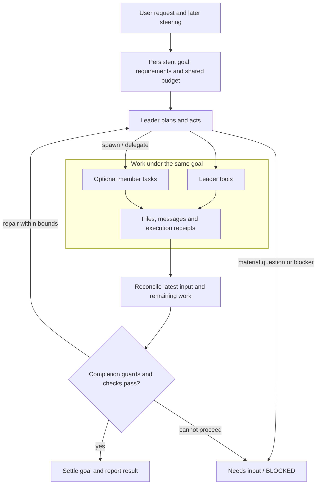
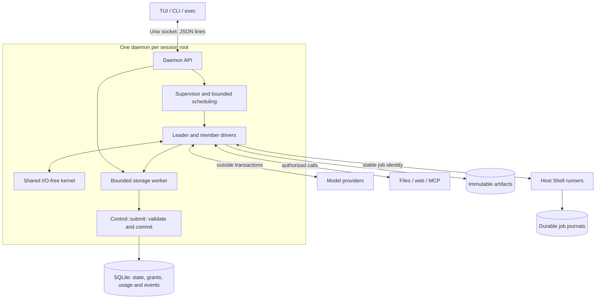
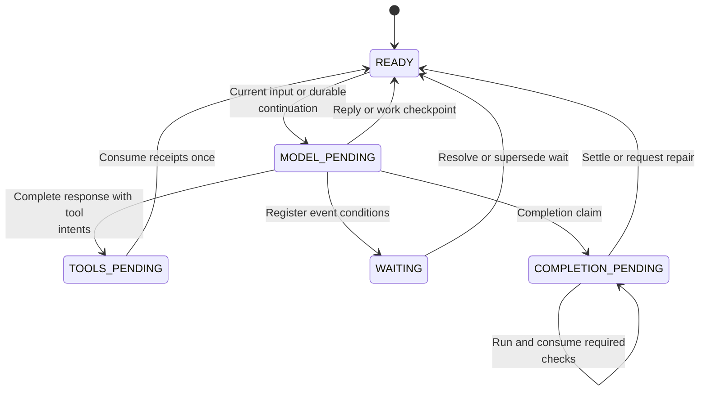
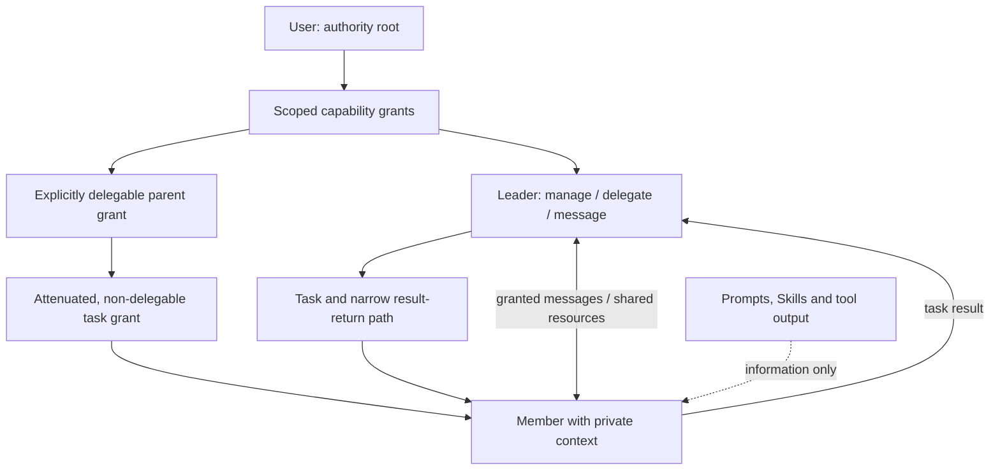
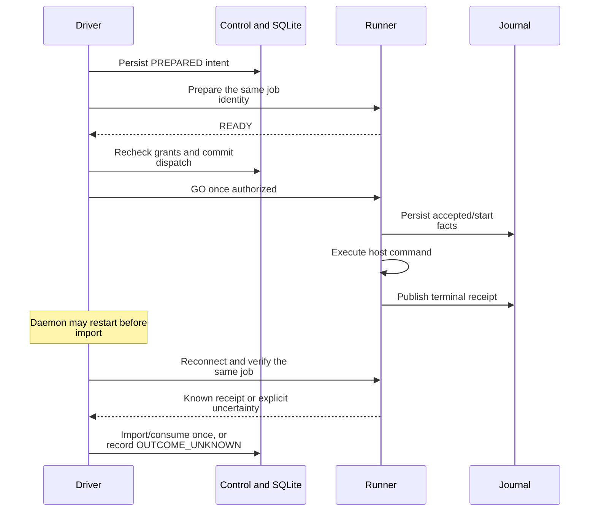

# TeamAgents

[Chinese README](README.zh-CN.md) · [Install](#install) · [Quick start](#quick-start) ·
[Full architecture](docs/ARCHITECTURE.md)

TeamAgents is a Linux terminal coding agent built around a Leader and optional worker instances. You describe
the goal; the Leader decides whether to work alone or delegate parts of it. A daemon keeps the session running
when you close the TUI, and each session stores its authoritative state in one SQLite database.

Within your instructions and intent, the agents are encouraged to explore, exercise judgment and deliver
thorough, verified work. Admitted goals persist across turns, compaction and restart; progress updates do not
finish the work, and routine choices need no repeated confirmation.

- The TUI and `teamagents exec` share a daemon, with snapshots and event watermarks for reconnect.
- Tasks, grants, budgets, approvals, receipts and events are persisted together. Recovery reuses verified
  results and records unknown outcomes instead of repeating side effects on a guess.
- Instances can use different models, tools and workspaces. The control plane checks grants when work is
  dispatched, including work that was queued before a grant was revoked.

## Design in five views

These five views explain the product and its execution model. The [full visual architecture](docs/ARCHITECTURE.md)
expands them into numbered diagrams, persistent keys, transition guards, wire frames and recovery cases.
Read that atlas alongside the linked source to implement the same behavior.

### 1. One goal, an optional team

A **goal** owns the whole admitted user request, its requirements and shared budget. A **task** is one delegated
assignment. An **instance** is a reusable actor with private context; the Leader is an instance with management
authority, not a different model engine. A turn or a progress message does not complete the goal.



[Goal/task/work states](docs/ARCHITECTURE.md#3-state-machines) ·
[Completion and evidence](docs/ARCHITECTURE.md#7-budget-and-completion)

### 2. Clients, runtime and the source of truth

Each session root has its own daemon, coordinator lock and SQLite database. TUI and headless clients share that
runtime. Instances are logical actors inside it; they do not each own a process or a database.



Closing a client leaves the daemon running. A committed job can survive a daemon restart. The kernel prepares
requests and interprets responses; the control plane owns authoritative state; the engine owns I/O; the TUI
owns presentation. The current format is database schema 7, socket protocol 1 and work policy 1.

[Deployment and bootstrap](docs/ARCHITECTURE.md#1-deployment-and-ownership) ·
[Data relationships and transactions](docs/ARCHITECTURE.md#2-durable-data)

### 3. A persistent loop with explicit stopping points

Execution phase records **where** an instance is; lifecycle and work state decide **whether and why** it should
continue. A paused instance, a blocked task and an unknown operation are different facts.



Enrolled work continues after progress prose, with bounded recovery for empty or repeating behavior. Material
questions wait for an answer; explicit user stops survive late results and restarts. After terminal work, an
information-only answer creates no goal, while actionable work is admitted internally with its original input,
policy and costs. Upgrading an old session does not silently enroll or restart it.

[Context construction and admission](docs/ARCHITECTURE.md#4-model-and-context-loop) ·
[All state dimensions](docs/ARCHITECTURE.md#3-state-machines)

### 4. Collaboration follows authority



Workers have no ambient Shell. Missing authority produces a capability request for the user. Revoking a parent
revokes its children, and dispatch checks current grants again. A task result does not grant general messaging
or another member's history. Ordinary authorized Shell and local MCP run on the host; these logical boundaries
are not an OS sandbox. Self-update retains its separate approval.

[Delegation, messages, waits and approvals](docs/ARCHITECTURE.md#5-team-and-authority) ·
[Tools and workspaces](docs/ARCHITECTURE.md#9-tools-and-resources)

### 5. Recovery reuses evidence



Unknown effects are not blindly retried. Task cancellation does not prove that a command stopped; overlapping
workspace takeover needs separate recorded stop evidence or an independent workspace. Required checks and
current-scope evidence gate success, but green commands alone do not prove semantic completeness.

[Runner, cancellation and takeover](docs/ARCHITECTURE.md#6-effects-and-recovery) ·
[Artifacts, fork and retention](docs/ARCHITECTURE.md#10-storage-lifecycle)

The atlas also covers the [client protocol and TUI](docs/ARCHITECTURE.md#8-clients-and-presentation) and a
[reimplementation order with a concrete trace](docs/ARCHITECTURE.md#11-reimplementation-checkpoints).
The tool layer includes revision-checked file edits, persistent member Shell, DeepSeek/Exa search, DeepSeek
fetch, on-demand Skills and stdio/HTTP MCP composed through bounded QuickJS. Models can use different native
protocols and windows in the same team. The TUI shares its Markdown/code/media renderer with saved history;
local evidence and its limits are recorded in the [maturity report](review/maturity-2026-10-11/REPORT.md).

## Documentation

| Document | Contents |
|---|---|
| [Visual architecture](docs/ARCHITECTURE.md) | Detailed diagrams, durable schemas, transition guards, recovery and reimplementation order |
| [User guide](docs/USER-GUIDE.md) | Commands, configuration, permissions, Skills/MCP, recovery and cleanup |
| [Daily coding readiness and candidates](docs/PRODUCT-COMPARISON.md) | Current scope, evidence limits and remaining candidate work |
| [Acceptance](docs/ACCEPTANCE.md) | Evidence for A01–A36 and known gaps |
| [Capabilities](docs/CAPABILITIES.md) | Capabilities, their checks and the limits of those checks |
| [Design baseline](docs/DESIGN.md) | Confirmed requirements, architecture and acceptance criteria |
| [Development](docs/DEVELOPMENT.md) | Toolchain, test gates and maintenance commands |
| [Decisions](docs/DECISIONS.md) | Confirmed decisions and their history |
| [Install guide](docs/INSTALL.md) | Download, source builds, upgrades and uninstall |
| [Formal verification](verification/README.md) | TLA+ and Kani properties, commands and unproven areas |

<!-- The reading map (D-443): every tracked document declares its reader and exactly one home, the map below
     points at it, and review/doc_inventory.py checks the three directions. The entry points need no line. -->
<!-- maps: docs/ACCEPTANCE.md reader=evidence -->
<!-- maps: docs/CAPABILITIES.md reader=evidence -->
<!-- maps: docs/DECISIONS.md reader=evidence -->
<!-- maps: docs/DESIGN.md reader=developer -->
<!-- maps: docs/ARCHITECTURE.md reader=developer -->
<!-- maps: docs/INSTALL.md reader=user -->
<!-- maps: docs/PRODUCT-COMPARISON.md reader=user -->
<!-- maps: docs/USER-GUIDE.md reader=user -->

New here? Start with the [install guide](docs/INSTALL.md). The published **v0.2.0** archive is an older
Linux x86_64 baseline; use a [source build](docs/INSTALL.md#build-and-install-from-source) for the current
behavior described here.

## Install

TeamAgents supports Linux x86_64. Model credentials come from environment variables and are not written to
the generated config.

### Install the published release

The v0.2.0 archive is statically linked against musl, so it does not need a Rust toolchain at runtime:

```bash
(
  set -eu
  installer="$(mktemp)"
  trap 'rm -f "$installer"' EXIT
  curl -fsSL https://raw.githubusercontent.com/seek-hope/TeamAgents/main/install.sh -o "$installer"
  sh "$installer"
)
export PATH="$HOME/.local/bin:$PATH"
teamagents init
```

The installer selects the latest release, verifies `SHA256SUMS`, and installs `teamagents` and
`teamagents-tui` together. Repeating it upgrades both binaries without replacing your config or sessions.
See the [install guide](docs/INSTALL.md) for `--version`, `--bin-dir` and local archives. Source builds may
contain changes that are not in v0.2.0.

### Building from source

```bash
cargo build --locked --release --manifest-path engine/Cargo.toml --bin teamagents
cargo build --locked --release --manifest-path tui/Cargo.toml --bin teamagents-tui
mkdir -p ~/.local/bin
install -m755 engine/target/release/teamagents tui/target/release/teamagents-tui ~/.local/bin/
export PATH="$HOME/.local/bin:$PATH"
```

Use the toolchain pinned in `rust-toolchain.toml`. Once dependencies are cached, add `--offline`.

## Quick start

```bash
teamagents init                       # create a minimal config and state root; preserve existing config
export DEEPSEEK_API_KEY='your key'    # the default model and DeepSeek search/fetch read this
export EXA_API_KEY='your Exa key'     # the default Exa search binding reads this
teamagents doctor                     # check config, credentials, state, Skills and host execution
teamagents --cwd /path/to/project     # omit --cwd to use the current directory
```

`init` writes an XDG-compliant config for DeepSeek Flash with its native 1M context and high reasoning effort.
It also binds DeepSeek + Exa search and DeepSeek fetch, so default `auto` searches may charge both search
providers. Use `provider = "deepseek"` or `"exa"` for one source, or remove the other binding. `init` never
merges new settings into an existing file; edit that file deliberately and inspect it with `doctor`.

Then describe the result you want:

```text
Make the tests under /tmp/proj pass and explain why each file changed.
```

The Leader chooses whether to delegate. Ordinary Shell calls run automatically on the host; workers still
need the appropriate capability grant. Self-update requires a separate user approval.

For scripts and CI, use `exec`. It shares the daemon with the TUI, and `-` reads the prompt from stdin:

```bash
teamagents exec "What is 1+1? Answer directly."
teamagents exec --json --timeout 180 "Make /tmp/proj tests pass"
teamagents exec --stream-json "Get the tests green" | jq -c '.event.kind'
teamagents exec --check "cargo test --offline" "Get the tests green"
teamagents exec --accept tests="pytest -q" "Fix the failing tests"
git diff | teamagents exec -
```

`--stream-json` emits one event object per line, followed by the same report object that `--json` prints.
Closing the consumer ends the stream, not the underlying run.

Exit codes are `0` for a completed goal or direct answer, `1` for failure or an unfinished run, `2` for usage
or infrastructure errors, `3` when approval or a material user answer is needed, and `124` when `--timeout` expires.

`--check COMMAND` runs after a finished turn and stops at the first failure. `--accept ID=COMMAND` attaches a
required check to the goal before the input is submitted, so a failure can trigger bounded repair instead of
merely changing the exit code. See [goal limits](docs/USER-GUIDE.md#22-goal-limits-limits) for token, deadline
and per-tool limits.

Manage capabilities through the same session:

```bash
teamagents authority
teamagents authority grant --subject i-worker-1 --action shell --scope workspace
teamagents authority grant --subject i-leader --action shell --scope workspace --delegable
teamagents authority revoke --grant g-1a2b3c4d
```

Every dispatch checks the current grants. Revoking a parent also revokes its children; task-scoped grants
expire with their task or instance.

## Common arguments and keys

| Usage | Meaning |
|---|---|
| `--cwd DIR` | Workspace for a new session. A running daemon keeps its existing workspace |
| `--state-root PATH` | State base, default `$XDG_STATE_HOME/teamagents/v2`; named sessions live below it |
| `--session ID` | Attach to a named session registered under that base |
| `--model KEY` | Select a model profile, default `leader_main` |
| `--every MINUTES` / `--prompt TEXT` | Set an automation's period and input |
| `--query TEXT` / `--limit N` | Set a session-search query and result limit |
| `--full-auto` | Compatibility flag; new sessions already use automatic host Shell |

Use `teamagents --help` for the complete command list. The main groups are `init`, `doctor`, `daemon`, `exec`,
`authority`, `approvals`, `instances`, `tasks`, `goals`, `runners`, `artifacts`, `sessions`, `automations`,
`mcp`, `status`, `history`, `surface` and `version`. `daemon --stop` stops the session that owns the selected
state root; closing the TUI does not.

Common TUI keys:

- `Enter` sends; `Ctrl+J` or `Shift+Enter` inserts a newline. `↑`/`↓` recall input or move within a draft;
  `PageUp`/`PageDown` and the mouse wheel scroll. `Ctrl+W` deletes a word and `Ctrl+←`/`Ctrl+→` move by word.
- `Ctrl+A` focuses approvals (`a` approves, `d` denies, `Esc` returns). `Ctrl+C` interrupts the current model
  request, not running tools or delegated work. `Ctrl+Q` or `/quit` closes the TUI without stopping the daemon.
- `Ctrl+M` or `/model` opens the Leader's model/effort menu. `Ctrl+P` or `/queue` opens pending input.
  `Ctrl+S` or `/sessions` opens session history and switching. `Ctrl+E` edits the draft in `VISUAL` or `EDITOR`.
- `Ctrl+O` expands or folds tool previews. `Ctrl+G` switches between previews and source.
  `TEAMAGENTS_GRAPHICS=auto|kitty|blocks|off` selects the graphics mode.

Slash commands are `/help`, `/sessions`, `/interrupt`, `/quit`, `/model`, `/attach`, `/detach`, `/queue` and
`/edit`. Completion fills a command without sending it; press Enter separately to submit. For a file reference,
type `@PATH` and Tab, then accept a candidate; the file is staged and sent only with your message.

For stored state, use `teamagents status --json` or
`teamagents history --id INSTANCE --limit 400 --json`. The [user guide](docs/USER-GUIDE.md#1-quick-start)
documents the remaining management commands and report fields.

## Configuration and team

- The user config is `$XDG_CONFIG_HOME/teamagents/config.toml`. TeamAgents also searches upward for
  `.teamagents/config.toml`, but project settings have no effect until you trust the canonical project root
  with `trusted_projects` or set `trust_project = true`. Your definitions win on name conflicts.
- Trusted projects can contribute model profiles, tool bindings, Skill paths and instruction files. They
  cannot contribute permissions, hooks, checks, retention, limits or update policy. Trusted `AGENTS.md` files
  are discovered from the repository boundary to the working directory; untrusted projects contribute none.
- A model profile selects `protocol = "responses" | "anthropic" | "openai" | "deepseek"`, an endpoint, a
  model and a credential variable. Use the model's native context window rather than an invented smaller one.
- Required `[[checks]]` belong only to the user config and run on the host. The Leader creates teams at runtime;
  there is no static team-definition file.

The [configuration section](docs/USER-GUIDE.md#2-configuration) covers precedence, limits and hooks.

## Status and limits

- Linux x86_64 is the supported build target. Windows, macOS, distributed workers and a general extension API
  are not supported product surfaces.
- Host Shell and local MCP have the host user's access. Remove retired sandbox settings explicitly when
  upgrading an old config; TeamAgents does not delete existing sessions, VMs or system packages for you.
- TeamAgents is suitable for controlled coding trials, but current evidence does not establish it as a
  drop-in replacement for Pi across general development work. The comparison and remaining candidates are in
  [PRODUCT-COMPARISON.md](docs/PRODUCT-COMPARISON.md).
- `engine/tests/providers_fake.rs` covers all four protocol families locally. Live provider, OAuth and image
  behavior depends on the service and credentials used; local tests are not live-service acceptance.
- [Acceptance evidence](docs/ACCEPTANCE.md) records what was tested, against which source, and what remains
  open. Historical benchmark results do not automatically apply to later source revisions.

## Development

Run `make check` before committing and `make pty` for terminal checks. See
[DEVELOPMENT.md](docs/DEVELOPMENT.md) for the complete workflow and [AGENTS.md](AGENTS.md) for repository
conventions. Review evidence lives in `review/`; formal-verification material lives in `verification/`.

A `v*` tag builds a release archive, but publication also requires the `TEAMAGENTS_RELEASE_APPROVED`
repository variable and explicit release authorization. The existing v0.2.0 release is not replaced by
ordinary source changes.

Chinese documentation: [README.zh-CN.md](README.zh-CN.md)
