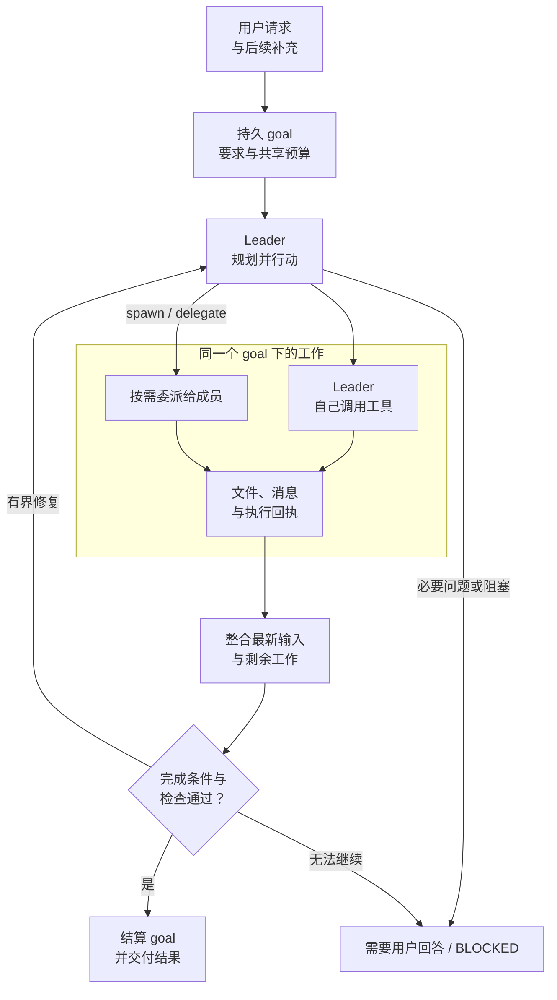
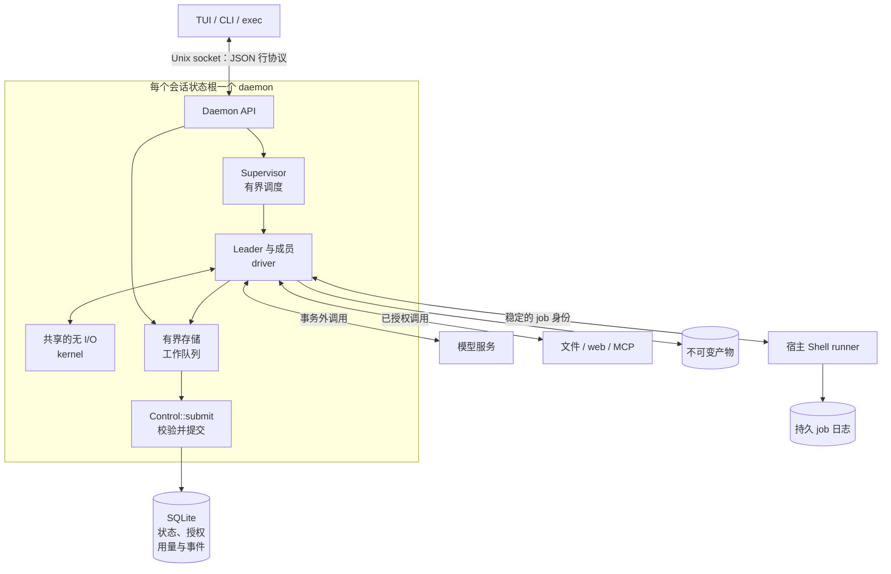
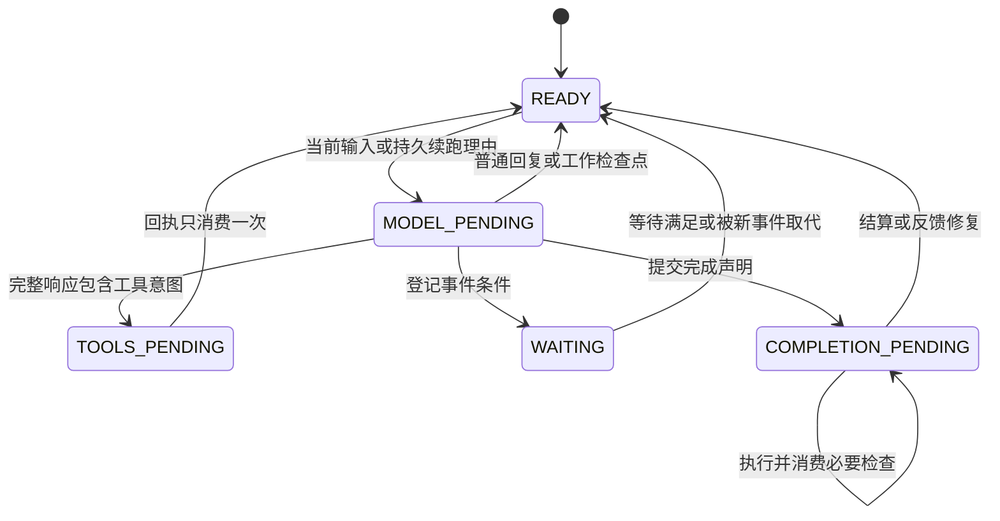
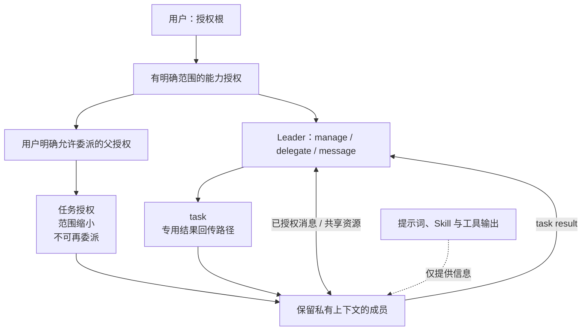
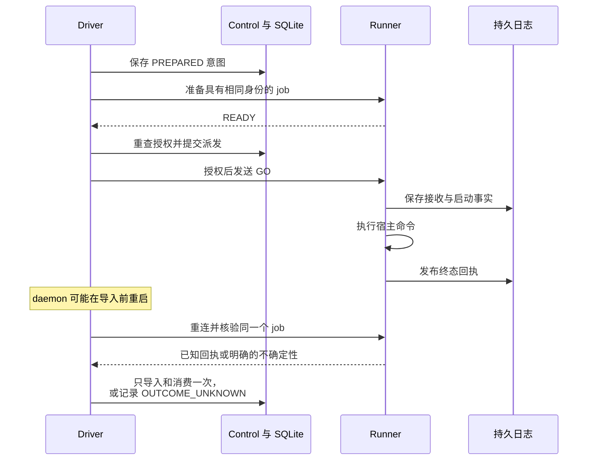

# TeamAgents

[English README](README.md) · [安装](#install) · [快速开始](#quick-start) ·
[完整架构图集](docs/ARCHITECTURE.md)

TeamAgents 是运行在 Linux 终端里的 coding agent。你只向 Leader 提出目标，由它决定独立完成任务，还是
创建工作实例并分派部分工作。关闭 TUI 后，daemon 会继续维护会话；每个会话的权威状态都保存在一个
SQLite 数据库中。

在服从你的指令、满足你的意图的前提下，鼓励模型自由探索、独立判断，充分完善和验证结果。已接纳的目标
跨模型回合、上下文压缩和重启持续存在；汇报进度不等于结束工作，常规选择也不需要反复请你确认。

- TUI 和 `teamagents exec` 共用 daemon，通过快照与事件位置恢复连接。
- 任务、授权、预算、审批、回执和事件一起持久化。恢复时复用已确认的结果；无法确认的外部结果记为未知，
  不会靠猜测重复执行副作用。
- 不同实例可以使用不同模型、工具和工作区。控制平面在派发时重新检查授权，包括授权撤销前已排队的任务。

## 五张图理解设计

这五张图说明产品结构和执行机制。[完整架构图集](docs/ARCHITECTURE.md)进一步给出各子系统的编号图、
持久化键、状态转换条件、协议报文和异常恢复路径。结合图集及其源码链接，可以逐层实现相同的行为。

### 1. 一个完整目标，按需组成团队

**goal** 承载整项已接纳的用户请求、验收要求和共享预算。**task** 是其中一次委派。
**instance** 是保留私有上下文、可重复使用的工作实例；Leader 是具有管理权限的实例，使用同一套模型执行核心。
一次模型回合结束或一条进度消息，都不等于 goal 完成。



[goal、task 与 work 状态](docs/ARCHITECTURE.md#3-state-machines) ·
[完成判定与证据](docs/ARCHITECTURE.md#7-budget-and-completion)

### 2. 客户端、运行时与权威状态

每个会话状态根拥有自己的 daemon、协调器锁和 SQLite 数据库。TUI 与 headless 客户端共用这一运行时。
实例是其中的逻辑角色，不会各自拥有一个进程或数据库。



关闭客户端后 daemon 继续运行；已提交执行的 job 可以跨 daemon 重启存活。kernel 构造请求和解释响应，
控制平面管理权威状态，engine 执行 I/O，TUI 负责展示。当前数据库 schema 为 7，socket 协议为 1，工作策略为 1。

[部署与启动](docs/ARCHITECTURE.md#1-deployment-and-ownership) ·
[数据关系与事务](docs/ARCHITECTURE.md#2-durable-data)

### 3. 持久循环与明确的停止条件

执行阶段记录实例运行到了**哪里**；生命周期与工作状态决定它**能否、为何继续**。
实例暂停、task 阻塞与操作结果未知，是三种不同的事实。



纳入新调度的工作会在进度回复后继续；空回复和重复行为只能进行有界恢复。必要问题等待用户回答，明确的用户
停止不会被迟到结果或重启撤销。终态工作之后，纯信息回答不建立新 goal；需要行动的新工作通过内部准入建立目标，
保留原始输入、策略和费用。升级旧会话不会静默启用新调度或重启旧工作。

[上下文构造与新工作准入](docs/ARCHITECTURE.md#4-model-and-context-loop) ·
[各类状态机](docs/ARCHITECTURE.md#3-state-machines)

### 4. 协作沿着授权发生



工作实例没有默认 Shell 权限；缺少权限时产生用户可处理的能力请求。撤销父授权会撤销子授权，派发时还会
重新检查当前授权。任务结果回传不会附赠通用消息通道或其他成员的历史。普通已授权 Shell 和本地 MCP 在
宿主执行，逻辑权限边界不是 OS 沙箱。自更新仍有单独审批。

[委派、消息、等待与审批](docs/ARCHITECTURE.md#5-team-and-authority) ·
[工具与工作区](docs/ARCHITECTURE.md#9-tools-and-resources)

### 5. 恢复依靠证据



未知副作用不会被盲目重试。取消 task 不证明命令已停止；重叠工作区的接管需要另外记录的停止证据，或使用
独立工作区。必要检查和当前工作范围内的证据约束成功结算，但命令全部退出成功不等于语义上的工作完整。

[runner、取消与接管](docs/ARCHITECTURE.md#6-effects-and-recovery) ·
[产物、分叉与历史保留](docs/ARCHITECTURE.md#10-storage-lifecycle)

图集还覆盖[客户端协议与 TUI](docs/ARCHITECTURE.md#8-clients-and-presentation)，以及
[复刻顺序和完整示例轨迹](docs/ARCHITECTURE.md#11-reimplementation-checkpoints)。工具层提供带版本校验的文件
编辑、按成员持久化的 Shell、DeepSeek/Exa 搜索、DeepSeek 抓取、按需加载的 Skill，以及通过有界 QuickJS
组合的 stdio/HTTP MCP。同一团队可以使用不同的模型原生协议与窗口。TUI 与已存历史共用 Markdown、代码和
媒体渲染器；相应本地证据及限制见[成熟度报告](review/maturity-2026-10-11/REPORT.md)。

## 文档

| 文档 | 内容 |
|---|---|
| [完整架构图集](docs/ARCHITECTURE.md) | 详细设计图、持久化结构、转换条件、恢复机制和复刻顺序 |
| [使用指南](docs/USER-GUIDE.md) | 命令、配置、权限、Skills/MCP、恢复与清理 |
| [日常编码能力与候选工作](docs/PRODUCT-COMPARISON.md) | 当前范围、证据边界和剩余候选工作 |
| [验收对照表](docs/ACCEPTANCE.md) | A01–A36 的证据与已知缺口 |
| [能力与证据](docs/CAPABILITIES.md) | 各项能力、对应检查及其证据边界 |
| [设计与验收基线](docs/DESIGN.md) | 已确认的需求、架构和验收标准 |
| [开发与维护](docs/DEVELOPMENT.md) | 工具链、测试门禁和维护命令 |
| [决策记录](docs/DECISIONS.md) | 已确认的决策及其历史 |
| [安装指南](docs/INSTALL.md) | 下载、源码构建、升级与卸载 |
| [形式化验证](verification/README.md) | TLA+、Kani、验证命令和未证明范围 |

初次使用请先看[安装指南](docs/INSTALL.md)。公开的 **v0.2.0** 安装包是较早的 Linux x86_64 基线；
本文描述的是当前源码行为，请通过[源码构建](docs/INSTALL.md#build-and-install-from-source)使用。

<a id="install"></a>

## 安装

TeamAgents 支持 Linux x86_64。模型凭据从环境变量读取，不会写入生成的配置文件。

### 安装已发布版本

v0.2.0 使用 musl 静态链接，运行时不需要 Rust 工具链：

```bash
(
  set -eu
  installer="$(mktemp)"
  trap 'rm -f "$installer"' EXIT
  curl -fsSL https://raw.githubusercontent.com/seek-hope/TeamAgents/main/install.sh -o "$installer"
  sh "$installer"
)
export PATH="$HOME/.local/bin:$PATH"
teamagents init
```

安装器选择最新 release，校验 `SHA256SUMS`，并一起安装 `teamagents` 和 `teamagents-tui`。再次运行会
升级两个二进制，同时保留配置和会话。`--version`、`--bin-dir` 和本地归档的用法见
[安装指南](docs/INSTALL.md)。源码构建可能包含尚未进入 v0.2.0 的修改。

### 从源码构建

```bash
cargo build --locked --release --manifest-path engine/Cargo.toml --bin teamagents
cargo build --locked --release --manifest-path tui/Cargo.toml --bin teamagents-tui
mkdir -p ~/.local/bin
install -m755 engine/target/release/teamagents tui/target/release/teamagents-tui ~/.local/bin/
export PATH="$HOME/.local/bin:$PATH"
```

请使用 `rust-toolchain.toml` 指定的工具链。依赖已缓存时，可以加上 `--offline`。

<a id="quick-start"></a>

## 快速开始

```bash
teamagents init                       # 创建最小配置和状态根；保留已有配置
export DEEPSEEK_API_KEY='你的模型密钥'  # 默认模型及 DeepSeek 搜索/抓取读取这个变量
export EXA_API_KEY='你的 Exa 密钥'      # 默认 Exa 搜索绑定读取这个变量
teamagents doctor                     # 检查配置、凭据、状态、Skills 和宿主执行环境
teamagents --cwd /path/to/project     # 省略 --cwd 时使用当前目录
```

`init` 按 XDG 目录约定生成 DeepSeek Flash 配置，使用原生 1M 上下文和 high 推理档位，并配置
DeepSeek + Exa 搜索和 DeepSeek 抓取。默认 `auto` 搜索可能同时产生两家搜索服务的费用；可用
`provider = "deepseek"` 或 `"exa"` 限定单一来源，或删除另一个绑定。`init` 不会把新增设置合并进已有文件；
请手动修改配置，再用 `doctor` 检查。

然后直接描述需要的结果：

```text
把 /tmp/proj 里的测试修到全绿，并解释每处修改的原因。
```

是否组队由 Leader 决定。普通 Shell 自动在宿主执行，但工作实例仍需相应的能力授权。自更新必须另外
经过用户批准。

脚本和 CI 使用 `exec`。它与 TUI 共用 daemon；参数写 `-` 时，从 stdin 读取提示词：

```bash
teamagents exec "1+1 等于几？直接回答"
teamagents exec --json --timeout 180 "把 /tmp/proj 的测试修绿"
teamagents exec --stream-json "改到测试全绿" | jq -c '.event.kind'
teamagents exec --check "cargo test --offline" "改到测试全绿"
teamagents exec --accept tests="pytest -q" "修好失败的测试"
git diff | teamagents exec -
```

`--stream-json` 每行输出一个事件对象，最后输出与 `--json` 相同的报告对象。关闭读取端只会结束
事件流，不会停止底层任务。

退出码：`0` 表示目标完成或直接回答，`1` 表示失败或未完成，`2` 表示用法或环境错误，`3` 表示操作
等待批准或必要的用户回答，`124` 表示 `--timeout` 到期。

`--check COMMAND` 在回合结束后运行，遇到第一条失败命令就停止。`--accept ID=COMMAND` 在提交输入前
把必要检查附加到目标；检查失败时可以进入有界修复，而不只是改变退出码。token、截止时间和单次工具
时限见[目标限制](docs/USER-GUIDE.md#22-goal-limits-limits)。

在同一会话中管理能力授权：

```bash
teamagents authority
teamagents authority grant --subject i-worker-1 --action shell --scope workspace
teamagents authority grant --subject i-leader --action shell --scope workspace --delegable
teamagents authority revoke --grant g-1a2b3c4d
```

每次派发都会检查当前授权。撤销父授权会同时撤销其子授权；任务级授权随任务或实例结束而失效。

## 常用参数与键位

| 用法 | 含义 |
|---|---|
| `--cwd DIR` | 新会话的工作目录；运行中的 daemon 保留原有目录 |
| `--state-root PATH` | 状态基目录，默认 `$XDG_STATE_HOME/teamagents/v2`；命名会话位于其下 |
| `--session ID` | 连接该基目录下已登记的命名会话 |
| `--model KEY` | 选择模型配置，默认 `leader_main` |
| `--every MINUTES` / `--prompt TEXT` | 设置自动任务的周期和输入 |
| `--query TEXT` / `--limit N` | 设置会话搜索内容和结果上限 |
| `--full-auto` | 兼容参数；新会话默认就会自动执行宿主 Shell |

完整命令列表请运行 `teamagents --help`。主要命令包括 `init`、`doctor`、`daemon`、`exec`、
`authority`、`approvals`、`instances`、`tasks`、`goals`、`runners`、`artifacts`、`sessions`、
`automations`、`mcp`、`status`、`history`、`surface` 和 `version`。`daemon --stop` 停止所选状态根
对应的会话；仅关闭 TUI 不会停止会话。

常用 TUI 键位：

- `Enter` 发送，`Ctrl+J` 或 `Shift+Enter` 换行。`↑`/`↓` 回顾输入或在草稿中移动；
  `PageUp`/`PageDown` 和鼠标滚轮翻页。`Ctrl+W` 删除单词，`Ctrl+←`/`Ctrl+→` 按单词移动。
- `Ctrl+A` 聚焦审批列表（`a` 批准、`d` 拒绝、`Esc` 返回）。`Ctrl+C` 中断当前模型请求，不会停止
  正在运行的工具或已委派工作。`Ctrl+Q` 或 `/quit` 关闭 TUI，daemon 继续运行。
- `Ctrl+M` 或 `/model` 打开 Leader 的模型与推理档位菜单。`Ctrl+P` 或 `/queue` 查看待处理输入。
  `Ctrl+S` 或 `/sessions` 打开会话历史与切换页面。`Ctrl+E` 使用 `VISUAL` 或 `EDITOR` 编辑草稿。
- `Ctrl+O` 展开或折叠工具预览。`Ctrl+G` 在预览和源码之间切换。
  `TEAMAGENTS_GRAPHICS=auto|kitty|blocks|off` 选择图形显示模式。

斜杠命令包括 `/help`、`/sessions`、`/interrupt`、`/quit`、`/model`、`/attach`、`/detach`、
`/queue` 和 `/edit`。补全只填入命令，仍需按 Enter 才会提交。输入 `@PATH` 后按 Tab 并选择候选，
可以暂存文件引用；文件只会随你之后发送的消息一起提交。

查看已存状态可使用 `teamagents status --json` 或
`teamagents history --id INSTANCE --limit 400 --json`。其余管理命令和报告字段见
[使用指南](docs/USER-GUIDE.md#1-quick-start)。

## 配置与团队

- 用户配置位于 `$XDG_CONFIG_HOME/teamagents/config.toml`。TeamAgents 也会向上查找
  `.teamagents/config.toml`，但只有用 `trusted_projects` 信任规范化后的项目根目录，或设置
  `trust_project = true`，项目配置才会生效。同名定义以用户配置为准。
- 可信项目可以提供模型配置、工具绑定、Skill 路径和指令文件，但不能提供权限、hooks、checks、
  retention、limits 或更新策略。系统会从项目边界到当前目录自动发现可信的 `AGENTS.md`；
  不可信项目不会提供这些文件。
- 模型配置通过 `protocol = "responses" | "anthropic" | "openai" | "deepseek"` 选择协议，并分别设置
  端点、模型和凭据变量。上下文窗口应使用模型的原生值，不要自行编造更小的值。
- 必要的 `[[checks]]` 只能来自用户配置，并在宿主执行。Leader 在运行时组队，不需要静态团队定义文件。

配置优先级、限制和 hooks 详见[配置章节](docs/USER-GUIDE.md#2-configuration)。

## 现状与限制

- 支持的构建目标是 Linux x86_64。Windows、macOS、分布式工作实例和通用扩展 API 目前不是受支持的
  产品能力。
- 宿主 Shell 和本地 MCP 拥有宿主用户的访问权限。升级旧配置时，需要手动删除已停用的沙箱设置；
  TeamAgents 不会替你删除现有会话、虚拟机或系统软件。
- TeamAgents 可以用于受控的编码试用，但现有证据尚不能证明它能在一般开发工作中直接替代 Pi。
  对比和后续候选工作见 [PRODUCT-COMPARISON.md](docs/PRODUCT-COMPARISON.md)。
- `engine/tests/providers_fake.rs` 在本地覆盖四类协议。真实供应商、OAuth 和图片行为取决于所用
  服务与凭据；本地测试不等于真实服务验收。
- [验收证据](docs/ACCEPTANCE.md) 记录了测试内容、对应源码和未决事项。历史基准结果不会自动适用于
  后续源码版本。

## 开发

提交前运行 `make check`，终端相关修改还要运行 `make pty`。完整流程见
[开发与维护](docs/DEVELOPMENT.md)，仓库约定见 [AGENTS.md](AGENTS.md)。评审证据位于 `review/`，
形式化验证材料位于 `verification/`。

`v*` tag 会触发发行包构建，但发布还需要仓库变量 `TEAMAGENTS_RELEASE_APPROVED` 和明确的发布授权。
普通源码修改不会替换已经发布的 v0.2.0。

英文版见 [README.md](README.md)。
