# TeamAgents visual architecture

This is the implementation map behind the [README](../README.md). Follow the diagrams in order to rebuild
the system's boundaries, durable data, execution rules and recovery behavior. The control/data reference is
source `028f2383` (D-487); D-489 updates the TUI presentation in view 23. Database schema **7**, socket
protocol **1**, and work policy **1** remain separate versions. [DESIGN.md](DESIGN.md) holds requirements; [DECISIONS.md](DECISIONS.md) resolves later choices;
[ACCEPTANCE.md](ACCEPTANCE.md) records evidence rather than assuming that a diagram proves correctness.

Each numbered view answers one implementation question. Arrows carry their meaning: calls, references,
authorization or state transitions. A box inside a transaction describes an atomic database change;
a model call, filesystem write or running process never belongs inside that box. State diagrams show
normal runtime paths; administrative overrides and exceptional paths are described beside them.

| Read in this order | What the implementation must preserve |
|---|---|
| [1. Deployment and ownership](#1-deployment-and-ownership) | Process boundaries, crate boundaries, authority and bootstrap |
| [2. Durable data](#2-durable-data) | Keys, relationships, provenance and atomic commits |
| [3. State machines](#3-state-machines) | Separate lifecycles for instances, work, goals, tasks and input |
| [4. Model and context loop](#4-model-and-context-loop) | Request freezing, response selection, compaction and admission |
| [5. Team and authority](#5-team-and-authority) | Delegation, grants, messages, waits and approvals |
| [6. Effects and recovery](#6-effects-and-recovery) | Dispatch, runner handshake, crashes and workspace takeover |
| [7. Budget and completion](#7-budget-and-completion) | Reservations, honest usage, checks and guarded settlement |
| [8. Clients and presentation](#8-clients-and-presentation) | Wire frames, reconnect, input ownership and bounded rendering |
| [9. Tools and resources](#9-tools-and-resources) | Files, Shell, web, MCP, Skills and workspace policies |
| [10. Storage lifecycle](#10-storage-lifecycle) | Artifacts, retention, fork, export and schema migration |
| [11. Reimplementation checkpoints](#11-reimplementation-checkpoints) | Build order, a worked trace and falsifiable acceptance cases |

## 1. Deployment and ownership

### 01. Processes and durable boundaries

One state root has one coordinator, one served session and one authoritative SQLite database. A named session
gets its own root. Instances are retained logical actors; creating an instance does not create an OS process
or reserve a model slot. Different roots do not share a transaction or a workspace lock.

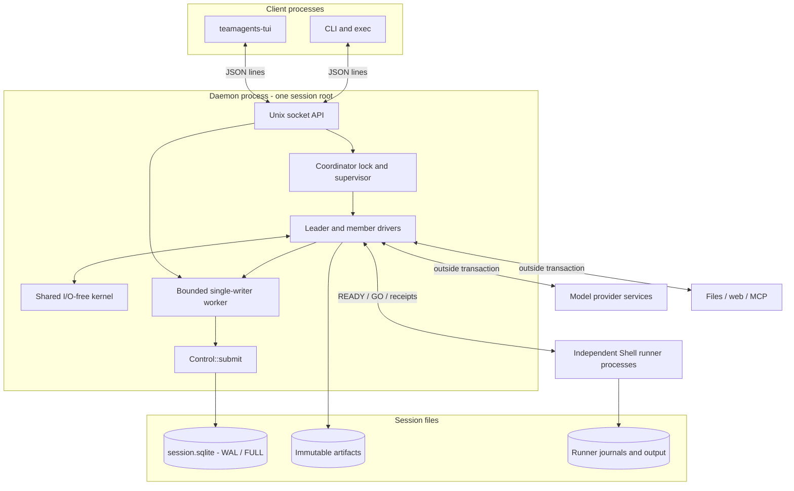

The daemon can outlive a client; a committed Shell job can outlive the daemon. Closing the TUI, interrupting a
model request, cancelling a task, stopping a job and terminating an instance are different operations. See
[view 18](#18-recover-from-facts) for their recovery consequences.

### 02. Responsibility and authority

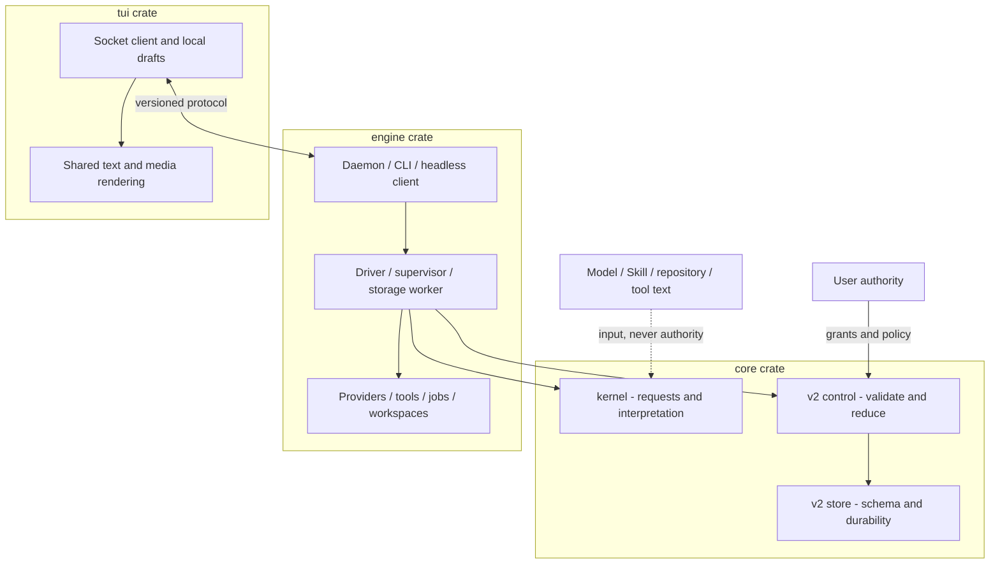

Controlled calls use trusted `User`, `System` or `Instance(id)` identities supplied by the runtime, not a model
argument. The user controls grants and instance termination. System identity performs internal accounting and
observations. Instance actions require their scoped grants. The private Unix socket represents the local user's
control surface. Same-user host Shell can access what that OS user can access: these logical rules are not a
confinement boundary against a hostile process running as that user.

Sources: [kernel](../core/src/kernel/instance.rs), [control](../core/src/v2/control.rs),
[store](../core/src/v2/store.rs), [storage worker](../engine/src/v2/storage.rs),
[supervisor](../engine/src/v2/supervisor.rs).

### 03. Bootstrap and configuration

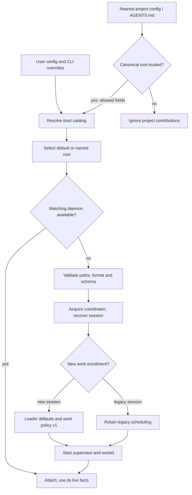

User definitions win on name conflicts. Trusted projects may contribute models, tool bindings, Skill paths and
instructions; permissions, hooks, checks, limits, retention and update policy remain user-owned. Explicit
instruction files precede discovered trusted `AGENTS.md` files. A running daemon keeps its boot catalog;
configuration diagnostics describe observed changes without silently applying them. Profile/effort switches
use the explicit safe-boundary path. Credentials are references to environment variables or local stores,
not prompt or event data.

Sources: [configuration](../engine/src/config.rs), [CLI](../engine/src/cli.rs),
[environment observations](../engine/src/environment.rs), [configuration reference](CONFIG.md).

## 2. Durable data

### 04. Work and assignment relationships

These are **logical relationships**, not a claim that SQLite declares foreign keys for every edge. The actual
DDL uses primary keys, unique indexes and control-plane validation. Lowercase entity names match table names;
fields shown are the keys and guards needed to understand the design, not every column.

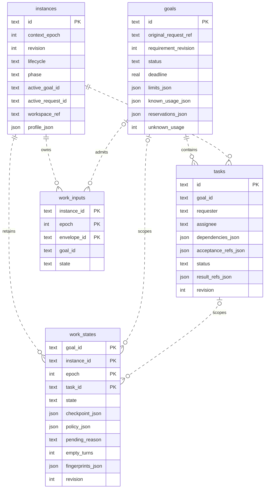

`work_states` uses `(goal_id, instance_id, epoch, task_id)` as its composite key. An empty `task_id` represents
root work; admission uses an empty goal key before there is a goal. These sentinels are not fabricated goal or
task rows. `work_inputs` states are `PENDING`, `ASSIGNED`, `ANSWERED` and `SUPERSEDED`. Pending inputs and inputs
assigned to an active goal retain their envelopes, including acceptance metadata, through history pruning.

A goal can involve several instances; an instance can serve successive goals and queued tasks. One instance
still has only one current execution position. Message topology can contain cycles; task dependency graphs
must remain acyclic. Session metadata, including work policy, lives in `meta`, not a separate sessions table
inside this database.

### 05. From input to external operation

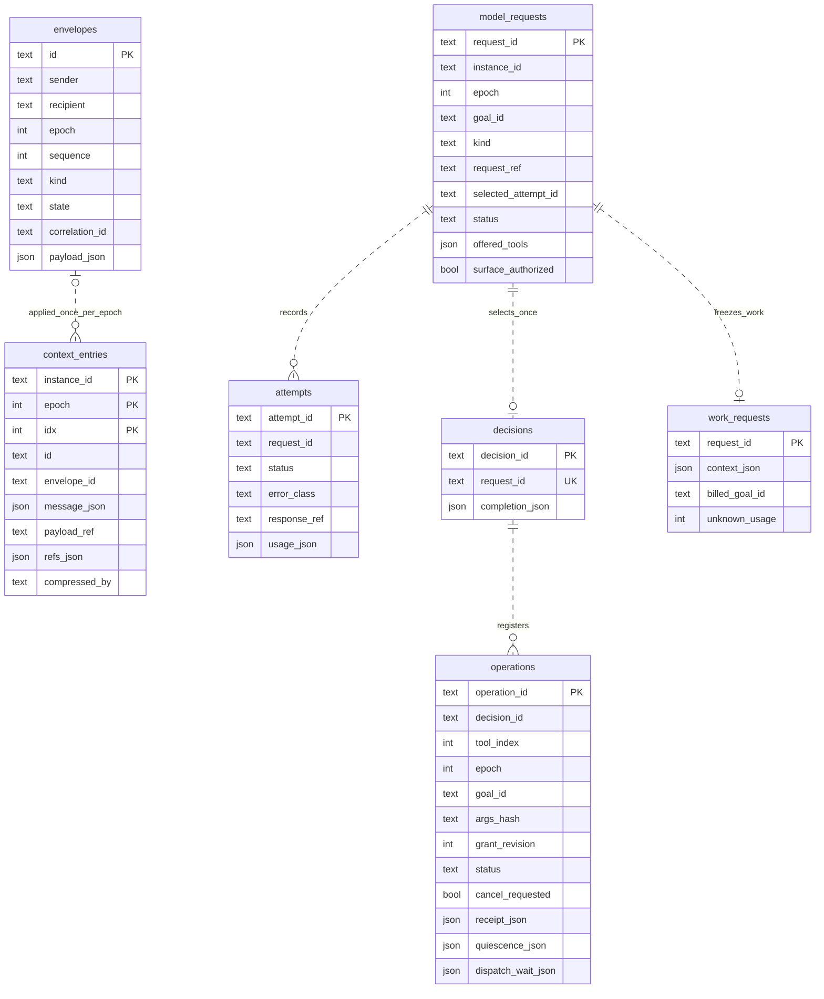

Three constraints prevent duplicate application: unique `(instance_id, epoch, envelope_id)` for non-null
envelope ids; unique `decisions.request_id`; unique `(decision_id, tool_index)` for operations. A request may
have many billed attempts but selects at most one response. Its immutable request artifact and frozen work
projection are different records. Admission leaves `model_requests.goal_id` NULL and later records billing in
`work_requests.billed_goal_id`; it does not rewrite the original request.

Required checks reuse synthetic requests, decisions and Shell operations. Their receipts remain execution
facts, not a separate unchecked table of model assertions. Input revisions, attachments, authority and
artifacts add the following records:

| Table | Key or essential constraint | Purpose |
|---|---|---|
| `meta` | `key` | Format/schema, session policy and control metadata |
| `commands` | `command_id`; hash includes method, params and trusted identity | Replay the same committed command receipt; reject a changed payload |
| `command_results` | Content `digest` | Share compressed result bodies without merging command identities |
| `events` | `(session_id, sequence)` | Ordered durable notifications with scope and payload |
| `grants` | `id`; optional parent/task; revision and revocation | Scoped authority and attenuation |
| `capability_requests` | `id`; subject, action, scope, task and status | User decision when no suitable delegable grant exists |
| `approvals` | `id`; operation, argument hash, grant revision and expiry | Approval of one concrete dispatch |
| `waits` | `id`; instance, epoch, ALL/ANY conditions and timer | Durable suspension without model polling |
| `input_revisions` | `(envelope_id, revision)` | Append-only edit/cancel history |
| `input_attachments` | `(envelope_id, ordinal)`; unique `artifact_id` | Immutable per-input attachment snapshots |
| `artifacts` | `id`; digest, owner, storage reference and completeness | Referenced bytes with explicit publication and collection states |

Together the diagrams and table cover every table in [the schema](../core/src/v2/store.rs). For exact columns,
nullability, indexes and additive upgrades, use `SCHEMA` and `ensure_columns` in that file. SQL strings at write
sites determine persisted status spelling; older convenience DTO enums are not the complete wire vocabulary.

### 06. The single commit boundary

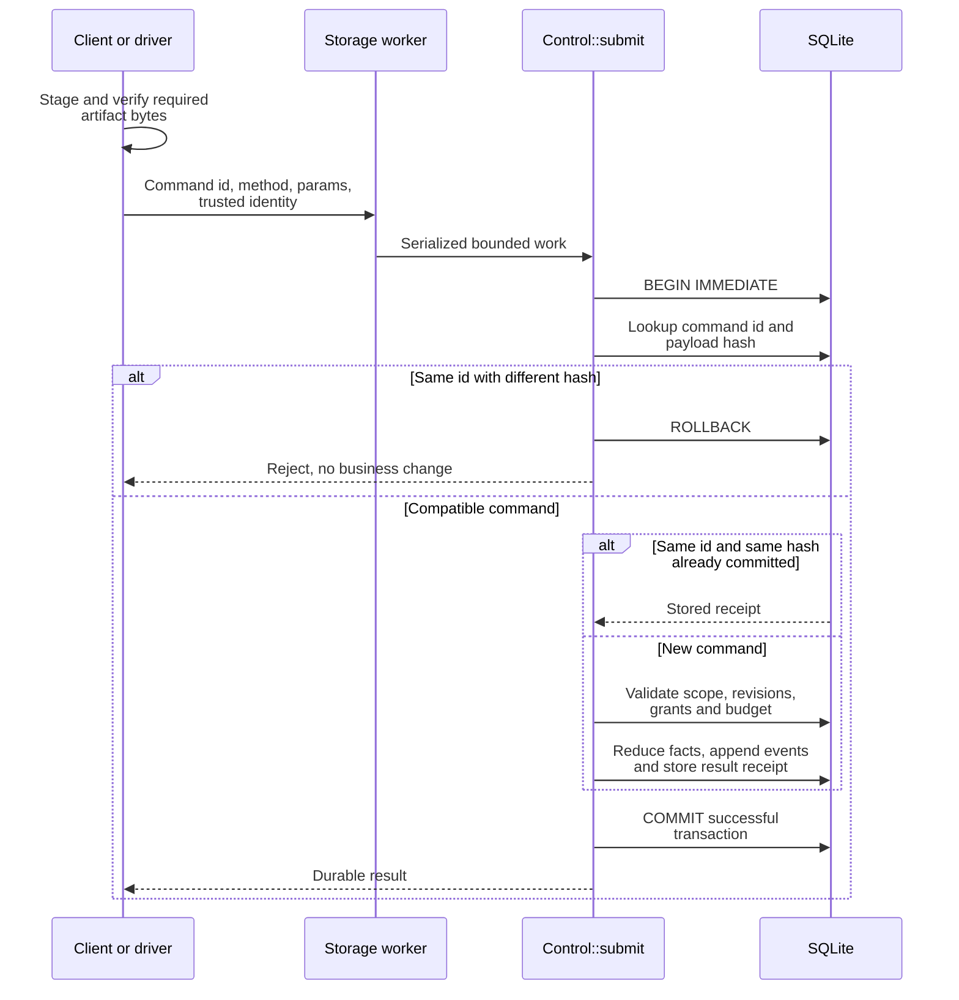

A fast receipt lookup may precede staging, but the authoritative duplicate check is inside `BEGIN IMMEDIATE`.
Validation failure rolls back all mutations. A cancelled caller future cannot roll back a transaction that
already committed: query or retry the same command id. Unchanged internal `drain_inbox` polls deliberately
store no receipt; a repeated poll may discover newly arrived input. This exception does not permit replaying
external effects. Model/tool waits never hold the transaction or the storage worker.

Atomic groups to reproduce:

| Boundary | Must commit together |
|---|---|
| Apply input | Envelope application, context append/dedup, work-input ownership, instance revision/phase |
| Import response | Selected attempt, usage, assistant entry, decision, intents/wait/completion and work update |
| Consume tool results | Receipt references in context, answer slots, phase and work continuation reason |
| Delegate or message | Task/message, grants or requests, delivery/ready facts and action receipt |
| Register or resolve wait | Conditions, current satisfaction check, answered slots and ready transition |
| Settle work | Current-scope guards, checks/evidence, goal/task outcome, grant cleanup and events |

Source: [Control::submit_inner and dispatch](../core/src/v2/control.rs).

## 3. State machines

### 07. State dimensions are independent

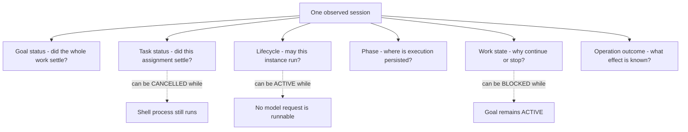

Never infer a process stop from a task status, a successful goal from a work checkpoint, or a pending task
result from the fact that an assignee is idle. Work `COMPLETE` also includes unsuccessful settlement; inspect
the goal/task outcome.

### 08. Instance lifecycle and execution phase

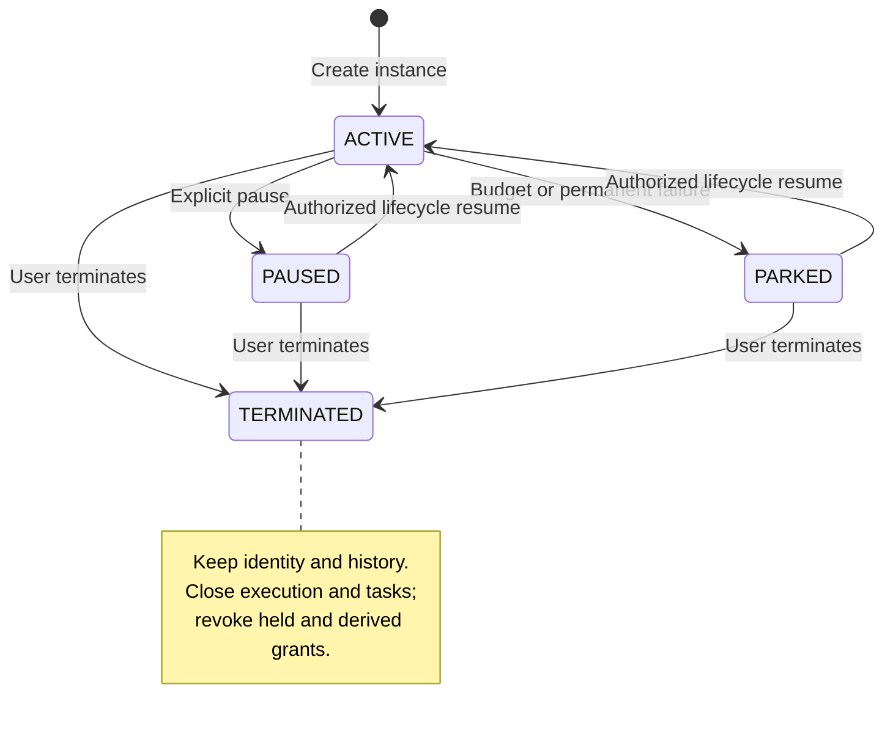

The user or an authorized manager can change lifecycle, but only the user can terminate an instance; System
identity may only park it. For enrolled work, changing lifecycle to ACTIVE through a manager does not clear
a durable STOPPED work record: `work::resume` is invoked by the explicit user path. Reset retains the instance
id, increments its context epoch and fences old input/results. Termination is irreversible for that id.

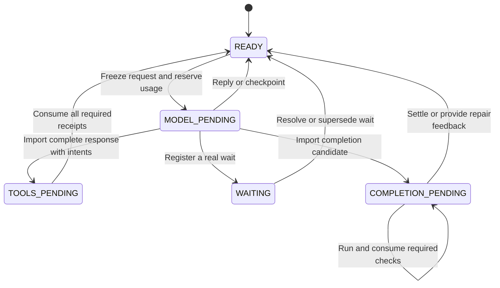

READY alone does not cause a call: lifecycle, work/input, scope and budget must all permit one.
Required-check operations reuse the tool execution path while the persisted phase stays COMPLETION_PENDING;
their receipts do not automatically start another model turn. Failures, interruption and epoch closure
normalize or park execution through control commands, rather than
jumping back into an old model/tool call. The phase diagram is the normal loop, not a substitute for the
[recovery decision tree](#18-recover-from-facts).

Sources: [lifecycle and phase types](../core/src/v2/models.rs),
[set_lifecycle / reset_instance](../core/src/v2/control.rs), [driver](../engine/src/v2/driver.rs).

### 09. Durable work and bounded continuation

```mermaid
stateDiagram-v2
    direction LR
    accTitle: Durable work state
    accDescr: Enrolled work persists through progress replies and restarts. Questions, waits, blocking and verification have distinct guarded paths; user stops follow the separate global rule below.
    [*] --> RUNNING: Admit / assign
    RUNNING --> RUNNING: Progress / repair
    RUNNING --> WAITING: Register wait
    WAITING --> RUNNING: Event / attention
    RUNNING --> NEEDS_INPUT: Ask user
    NEEDS_INPUT --> RUNNING: Relevant answer
    RUNNING --> BLOCKED: Block / exhausted
    BLOCKED --> RUNNING: Input / recovery
    RUNNING --> VERIFYING: Claim completion
    VERIFYING --> RUNNING: Input / repair
    VERIFYING --> BLOCKED: Cannot finish
    VERIFYING --> COMPLETE: Settle
```

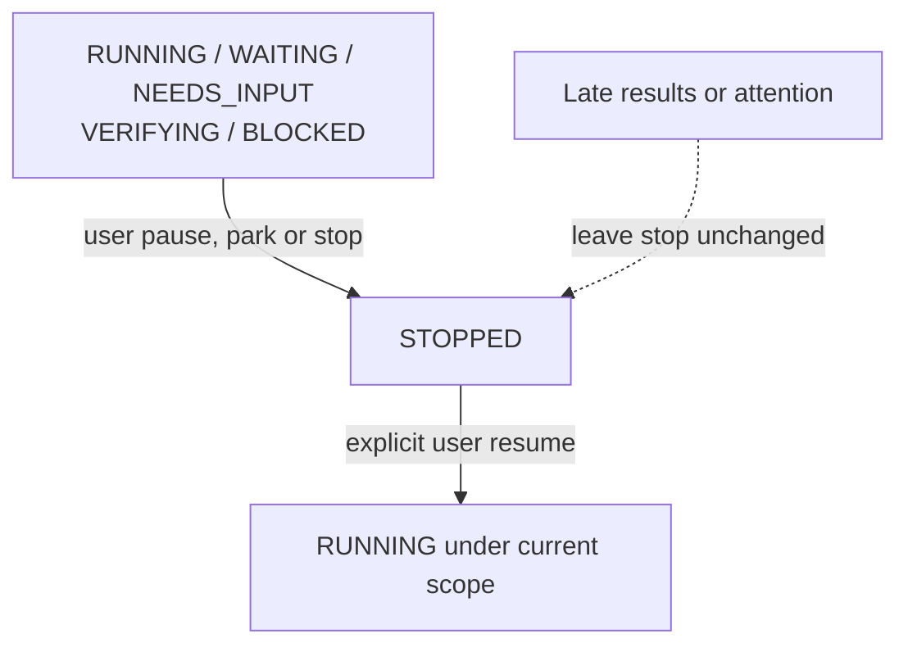

These paths also require a runnable lifecycle and the current assignment. Terminal historical work is not
reopened. Stopping during verification or blocking uses the same STOPPED rule. A model `blocked` report for
Leader work can preserve an ACTIVE goal with its existing budget; exhausting required-check rounds can instead
block the goal. These are different mechanisms.

`work_checkpoint` must be the only tool call in its response. Its actions are `start_work`, `continue`,
`ask_user` and `blocked`; they require an objective, next step, question or reason respectively. Checkpoints
are bounded **model claims**: merged payload at most 32 KiB and list fields at most 128 strings. They do not
mint authority, certify files or replace receipts. Two unproductive recovery continuations are allowed; the
third unproductive response blocks. The last six action/observation fingerprints also bound repeated
one-step or two-step patterns. Restart, compaction and plan edits do not replenish these counters; relevant
new inputs or observations can start a new episode.

Sources: [work state and completion guards](../core/src/v2/control/work.rs),
[shared behavior and harness](../engine/src/v2/work.rs).

### 10. Goal, task and input lifetimes

```mermaid
stateDiagram-v2
    accTitle: Goal outcomes
    accDescr: A goal remains active over many turns and instances. Success requires completion guards; failed, blocked and cancelled goals keep their history and are not automatically reopened.
    [*] --> ACTIVE: Admit whole work
    ACTIVE --> ACTIVE: Turns, delegation,<br/>compaction and restart
    ACTIVE --> SUCCEEDED: Current claim and all gates<br/>pass
    ACTIVE --> FAILED: Failed completion
    ACTIVE --> BLOCKED: Required-check policy<br/>blocks goal
    ACTIVE --> CANCELLED: Explicit cancellation
    note right of ACTIVE
        A material question or blocked
        work record can leave this
        goal ACTIVE without scheduling.
    end note
```

```mermaid
stateDiagram-v2
    accTitle: Assignment task states
    accDescr: Missing capability suspends an assignment before execution. Blocked tasks are not settled results; cancellation or an authorized explicit settlement is needed before a task-result wait can complete.
    [*] --> PENDING: Delegate with authority
    [*] --> WAITING_CAPABILITY: Required capability<br/>unavailable
    WAITING_CAPABILITY --> PENDING: User grants required<br/>capability
    WAITING_CAPABILITY --> CANCELLED: User denies capability
    PENDING --> RUNNING: Assignee starts
    PENDING --> CANCELLED: Cancel before live turn
    RUNNING --> SUCCEEDED: Verified successful result
    RUNNING --> FAILED: Failed result
    RUNNING --> BLOCKED: Blocked result or<br/>unresolved live<br/>cancellation
    BLOCKED --> CANCELLED: Explicit cancellation
    note right of BLOCKED
        Does not satisfy a task-result wait.
        Re-dispatch recovered work as a new task;
        user settlement is an explicit override.
    end note
```

Task outcomes `SUCCEEDED`, `FAILED` and `CANCELLED` satisfy a task-result condition; `BLOCKED` does not.
Cancellation during a live turn can first leave a blocked assignment. The control API also permits explicit
user settlement of an open task; it does not turn that act into evidence that its command stopped.

```mermaid
stateDiagram-v2
    accTitle: User input delivery
    accDescr: Inputs are queued or deferred until a safe boundary. Edits compare identity and revision; applied means added to context, not that the model completed the requested work.
    [*] --> ACCEPTED: Normal submission
    [*] --> DEFERRED: after equals turn
    DEFERRED --> ACCEPTED: Current turn closes
    ACCEPTED --> APPLIED: Safe-boundary append and<br/>dedup
    ACCEPTED --> ACCEPTED: Revision-checked edit
    ACCEPTED --> CANCELLED: User cancels before<br/>application
    ACCEPTED --> SUPERSEDED: Epoch reset seals delivery
    DEFERRED --> SUPERSEDED: Epoch reset seals delivery
```

Only current-epoch ACCEPTED inputs can be edited or cancelled through the revision commands; DEFERRED input
must first be promoted. New input cannot bypass earlier accepted input, reset an active budget or revive a
PARKED instance.
Attachments are immutable workspace-confined snapshots created by the engine, not client-supplied artifact
identities. A newly queued input invalidates a completion claim that did not incorporate it.

Sources: [goal/task/input commands](../core/src/v2/control.rs),
[input snapshots](../engine/src/v2/attachments.rs), [input persistence](../core/src/v2/attachments.rs).

## 4. Model and context loop

### 11. Prepare, call and select one response

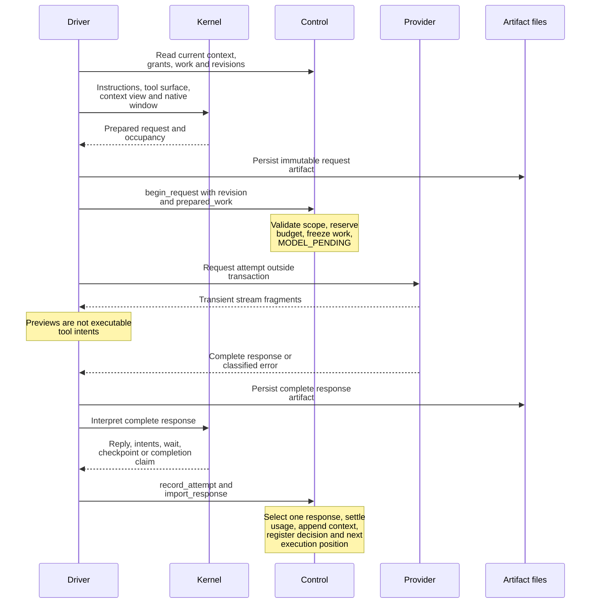

Preparation compares goal, instance epoch, task, admission id, work revision and state at the commit boundary.
A changed assignment/input causes re-preparation. Frozen scope is checked again when a response or completion
is consumed. One request's late alternative response may be archived and billed, but cannot create a second
set of tool intents. Partial streams never dispatch tools.

The driver owns transport retries. Transient failure before visible text may retry up to configured
`max_retries`; once visible text escaped, or a protocol/permanent error occurred, the attempt fails explicitly.
Context overflow takes its own recovery path. Model repair turns, failed transport attempts and compression
calls are separate events and costs.

Sources: [driver request/response steps](../engine/src/v2/driver.rs),
[kernel interpretation](../core/src/kernel/instance.rs), [providers](../engine/src/providers/mod.rs).

### 12. Context construction and compaction

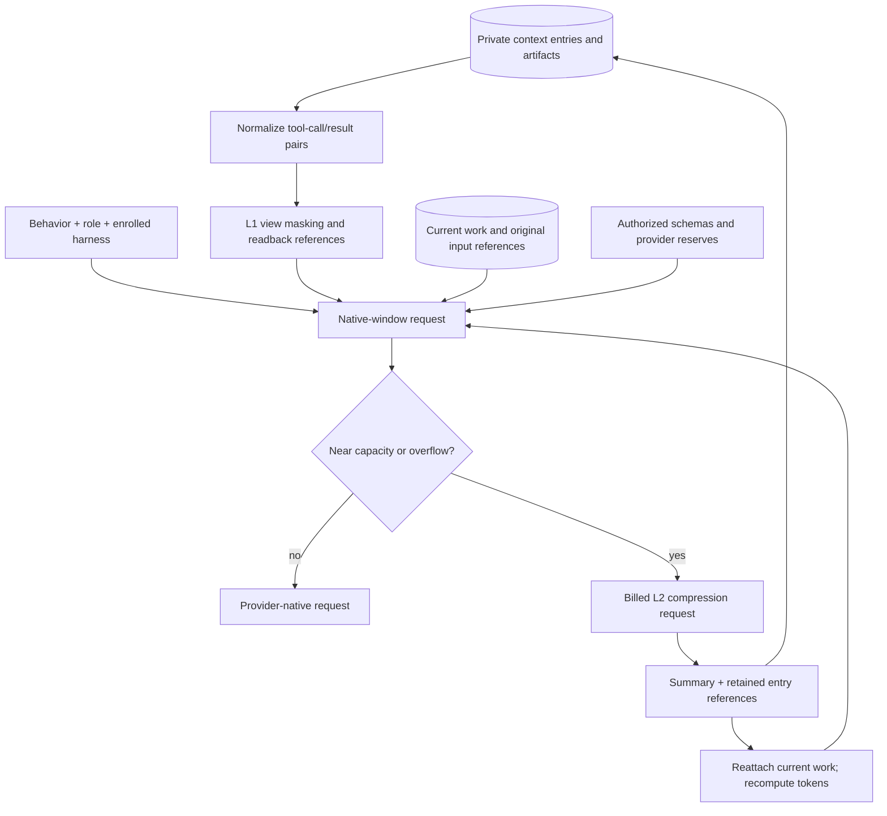

L1 changes the wire view of old tool outputs, keeping the original content addressable. Its mask frontier is
frozen between compactions to preserve a stable provider cache prefix. L2 is a recorded model request, normally
triggered near 90% of the native window or by overflow; it marks covered entries with `compressed_by` and keeps
originals available for readback. An explicit context reset is a different operation and bumps the epoch.

The window must include instructions, schemas, history, output and protocol reserves. DeepSeek Flash uses its
confirmed native 1M configuration. Provider-specific reasoning and tool-correlation fields retain their native
meaning; incompatible profile changes use an explicit context handover. Cache hit/miss/write are reported
only when the provider reports them. A 32 KiB work checkpoint is a bound, not a guarantee that every possible
profile can fit it. Overflow must remain visible.

Sources: [request materialization](../core/src/kernel/instance.rs),
[context types](../core/src/kernel/types.rs), [compression integration](../engine/src/v2/driver.rs).

### 13. New work after terminal work

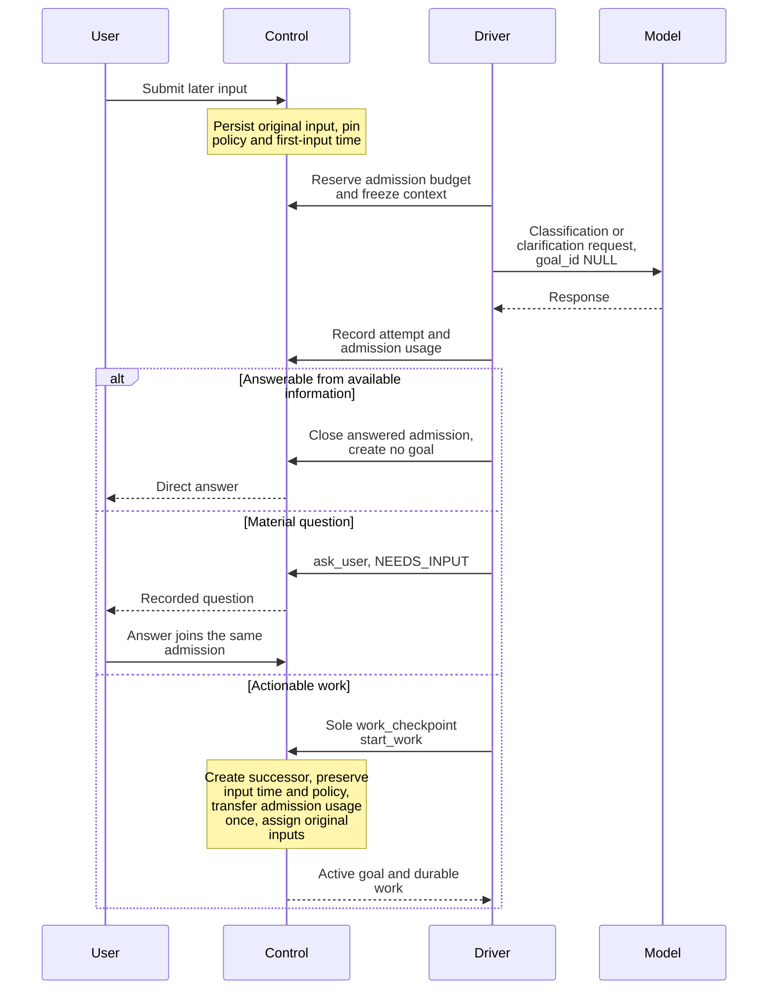

Explicit user acceptance checks can admit work without the model classification step. An information-shaped
question that needs investigation or tools is actionable work. Ordinary tools and waits cannot run before
admission. An active goal's `start_work` cannot create a fresh allowance. A previous blocked/cancelled goal
requires explicit recovery/new-goal action. An unrelated later goal does not inherit the costs of an already
answered informational exchange. The original request's NULL goal remains unchanged; billing uses the separate
association shown in [view 05](#05-from-input-to-external-operation).

Sources: [admission](../core/src/v2/control/work/admission.rs),
[scope and work projection](../core/src/v2/control/work.rs).

## 5. Team and authority

### 14. Delegation with an explicit return path

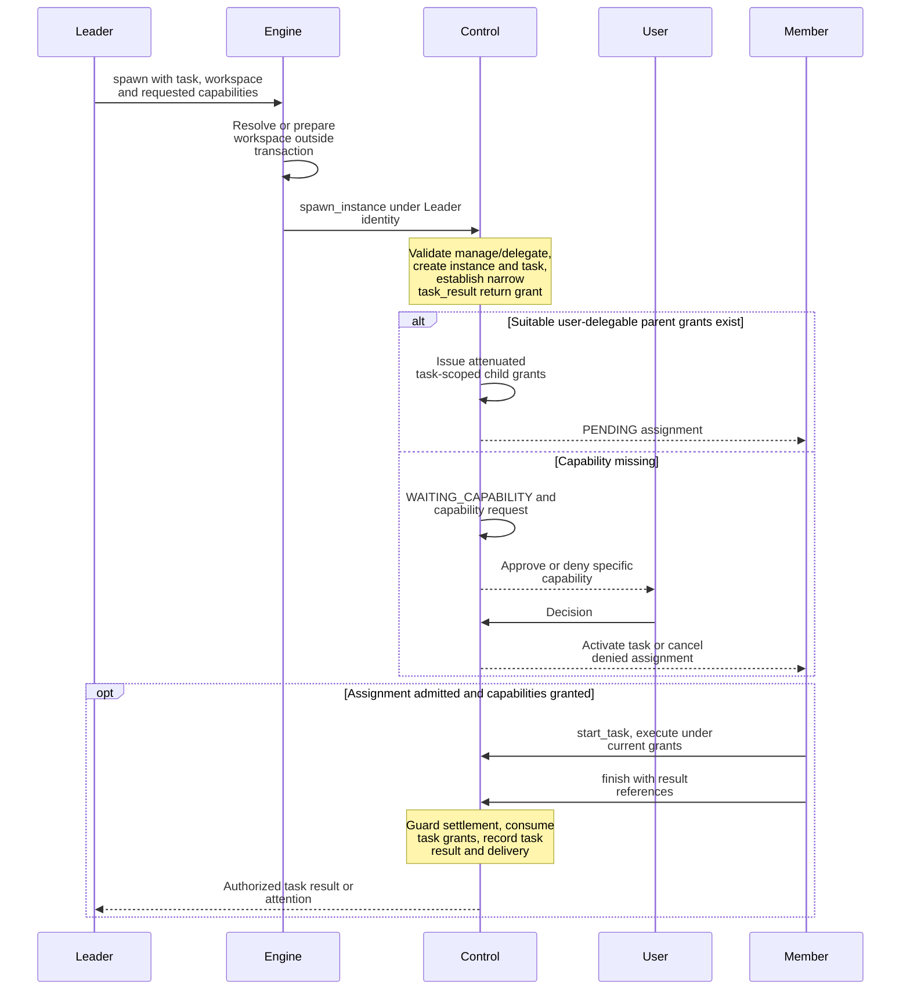

The Leader starts with management/delegation/message authority; spawned members have no ambient Shell.
Only user-marked delegable parents produce task-scoped child capabilities. Child scope cannot widen and
children are non-delegable. Revocation cascades; task settlement/instance retirement retires associated grants.
A task return path does not create a general reverse message channel or private-history access. Denying a
capability request cancels the assignment without executing it and returns the cancellation to the delegator.

Sources: [spawn/delegate/capability commands](../core/src/v2/control.rs),
[capability predicates](../core/src/v2/capability.rs), [workspace preparation](../engine/src/workspace.rs).

### 15. Visibility, delivery and event waits

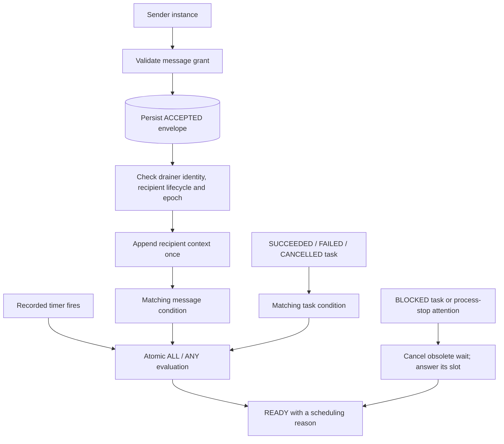

A user may inspect every instance's history; an instance's controlled history read is confined to itself.
Shared files, granted messages and task-result references are explicit sharing paths. Being visible in a user
snapshot does not mean being injected into a model prompt. Sending checks the message grant; draining checks
the caller, recipient session/lifecycle and epoch. The current drain does not revalidate the sender's grant,
so revocation does not retract an already ACCEPTED message. Nor can it remove information already read.

Wait registration checks already-satisfied conditions inside the same transaction, preventing lost wakeups.
A delegated result never satisfies a `message` condition. `BLOCKED` never satisfies a `task` condition.
Enrolled-work attention, input or stop evidence can supersede a wait while leaving its conditions unsatisfied;
this is a cancellation/wakeup, not manufactured task success. STOPPED/PARKED and unanswered material questions
retain their stronger guards. Legacy unenrolled work keeps its earlier scheduling. Cycle diagnosis evaluates
ALL/ANY conditions and external fulfillment, not just cycles in the communication graph; it never auto-cancels
a task because of a cycle or silence.

Sources: [envelope/wait handlers](../core/src/v2/control.rs),
[attention and wakeup](../core/src/v2/control/work.rs), [wait model](../verification/tla/V2Wait.tla).

### 16. Authorization at dispatch

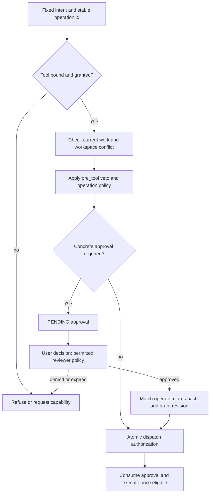

Ordinary authorized host Shell does not require a per-command approval. Capability requests and concrete
operation approvals are different records. Self-update retains separate user approval. The existing optional
reviewer policy cannot create missing capability grants. A grant change requires reauthorization; an old
approval is not valid for changed arguments or a new permission revision. PENDING approvals expire when their
operation settles or their instance terminates. Revocation before dispatch refuses it; revocation after the
authorization boundary cannot erase an effect that already started.

Sources: [operation and approval commands](../core/src/v2/control.rs),
[approval execution](../engine/src/v2/approvals.rs), [reviewer](../engine/src/v2/reviewer.rs),
[hooks](../engine/src/hooks.rs).

## 6. Effects and recovery

### 17. Shell dispatch and runner handshake

```mermaid
sequenceDiagram
    accTitle: Durable Shell start protocol
    accDescr: A runner locks one job and reports READY before authorization is committed. GO is deduplicated, the runner persists start and result facts independently, and the daemon imports its verified receipt.
    participant Driver
    participant Control
    participant Runner
    participant Shell
    participant Journal
    Driver->>Control: Register PREPARED operation
    Driver->>Runner: Start or reconnect same job<br/>identity
    Runner->>Runner: Acquire unique job lock
    Runner-->>Driver: READY, command has not<br/>started
    Driver->>Control: Recheck scope, grants,<br/>budget and approval
    Control-->>Driver: DISPATCH_COMMITTED
    Driver->>Runner: GO with operation identity
    Runner->>Journal: Persist accepted marker
    Runner->>Shell: Start command process group
    Runner->>Journal: Persist boot/process<br/>identity
    Shell-->>Runner: Output and real<br/>exit/cancel/timeout
    Runner->>Journal: Atomically publish terminal<br/>receipt
    Driver->>Runner: Reconnect/read verified<br/>receipt
    Driver->>Control: Import unique operation<br/>outcome
    Driver->>Control: Consume receipt references<br/>into context once
```

Duplicate GO never starts a second command. CANCEL before start persists `CANCELLED_BEFORE_START` and rejects
late GO. Once the start boundary is crossed, cancellation requests a process-group stop and preserves the
real effect/outcome. A crash after accepted GO but before a PID record is **unknown**, not evidence of no start.
The runner writes its journal, not the session database. cwd/exports are preserved per member from verified
receipts. Successful commands may leave services running; exiting the TUI does not clean those services up.

```mermaid
stateDiagram-v2
    accTitle: Operation outcome and cancellation
    accDescr: An operation moves from prepared through committed dispatch to a recorded outcome. Unknown is preserved as an outcome; a later observation of process absence is stored separately.
    [*] --> PREPARED
    PREPARED --> DISPATCH_COMMITTED: Authorization commits
    PREPARED --> CANCELLED_BEFORE_START: Cancel before start
    DISPATCH_COMMITTED --> RUNNING: Execution observed
    DISPATCH_COMMITTED --> CANCELLED_BEFORE_START: Runner proves no start
    DISPATCH_COMMITTED --> OUTCOME_UNKNOWN: Start cannot be verified
    RUNNING --> SUCCEEDED: Verified success receipt
    RUNNING --> FAILED: Verified failure receipt
    RUNNING --> CANCELLED: Verified cancellation<br/>receipt
    RUNNING --> OUTCOME_UNKNOWN: Outcome cannot be verified
    OUTCOME_UNKNOWN --> OUTCOME_UNKNOWN: Attach separate quiescence<br/>observation
```

This operation diagram distinguishes protocol facts, including the observed running state. The current Shell
path can keep its SQLite operation DISPATCH_COMMITTED while its runner journal says RUNNING, then import the
terminal receipt directly. RUNNING is also recognized by control guards; do not require a separately committed
SQL RUNNING row as proof that GO happened. A setup failure can settle without ever starting a command. Terminal receipts are immutable: identical import is idempotent and a
different replacement is refused. `cancel_requested` and `quiescence_json` are separate fields, not success
states. Known-independent read-only batches may execute concurrently; effects otherwise retain ordered dispatch
and receipts. There is no global serialization of arbitrary Shell writes.

Sources: [runner](../engine/src/jobs/runner.rs), [job client](../engine/src/jobs/client.rs),
[operation dispatch/import](../core/src/v2/control.rs), [driver tools](../engine/src/v2/driver.rs).

### 18. Recover from facts

```mermaid
flowchart TB
    accTitle: Recovery from persisted facts
    accDescr: Recovery chooses an action from verified receipts, published responses, dispatch records and process identity. Unknown effects are parked rather than replayed.
    recover["Restart or reconnect"] --> inspect["Read phase, request, operation and journals"]
    inspect --> receipt{"Verified result exists?"}
    receipt -->|"yes"| reuse["Import or consume once"]
    receipt -->|"no"| response{"Complete response artifact exists?"}
    response -->|"yes"| select["Verify request identity; select/import once"]
    response -->|"no"| boundary{"Effect dispatch committed?"}
    boundary -->|"no"| prepare["Revalidate before first dispatch"]
    boundary -->|"yes"| job{"Same job verifiable?"}
    job -->|"yes"| reconnect["Reconnect; obey current GO/CANCEL state"]
    job -->|"no"| unknown["OUTCOME_UNKNOWN; park affected work"]
    unknown --> inspect_effect["Inspect evidence; never blindly replay"]
```

The effect branch applies to tools. A model request without a complete response follows the bounded model
retry/recovery policy and records possible unknown usage. A persisted user command whose reply was lost uses
the same `command_id`. A result already in SQLite but not consumed only needs context advancement. Late results
remain attributed to their original operation/goal and cannot enter a new epoch or assignment.

| User/runtime action | Immediate meaning | What it does not establish |
|---|---|---|
| Close TUI / consumer | Detach a client | Daemon or job stopped |
| Interrupt Leader model request | Cancel that request; preserve honest attempt accounting | Shell/member cancellation |
| Pause/park instance | Stop scheduling new work | In-flight external effect ceased |
| Cancel task | End/release the assignment according to its live-turn state | Its command process stopped |
| Cancel controlled job / timeout | Persist cancellation and request group stop | Unknown remote effects vanished |
| Stop daemon | Stop driving this session; retain durable position and recoverable jobs | Workspace rollback or service cleanup |
| Full disk/write failure | Freeze new dispatch; report persistence failure | Unsaved result/cancellation became durable |

With storage failure, an identity-verified stop path can still attempt to stop a controlled job. Record
separately whether cancellation was saved and whether the process stopped. Do not claim either fact from the
other. These are internal deduplication and recovery guarantees, not exactly-once execution of arbitrary APIs.

Sources: [driver recovery](../engine/src/v2/driver.rs), [jobs](../engine/src/jobs/mod.rs),
[supervisor shutdown](../engine/src/v2/supervisor.rs).

### 19. Workspace takeover after cancellation

```mermaid
flowchart TB
    accTitle: Shared workspace takeover guard
    accDescr: A new effect checks for overlapping retired execution. A separate identity-bound observer can record local process-group absence without changing an unknown receipt or proving remote quiescence.
    next["New effect in current work"] --> overlap{"Overlapping retired execution?"}
    overlap -->|"no"| dispatch["Continue dispatch checks"]
    overlap -->|"yes"| proof{"Recorded stop evidence?"}
    proof -->|"yes"| dispatch
    proof -->|"no"| hold["Record dispatch wait; block shared effect"]
    hold --> observe["Verify journal, command hash, boot and process identity"]
    observe --> absent{"Recorded group absent?"}
    absent -->|"no or uncertain"| hold
    absent -->|"yes"| record["Persist quiescence observation separately"]
    record --> attention["Notify relevant work; preserve unknown receipt"]
    attention --> next
    hold -.->|"alternative"| isolated["Independent workspace and explicit integration"]
```

Observation does not send a termination signal. A READY journal cannot prove stop; permission denied is not
process absence. The guard uses declared overlapping workspace paths and tracked retired operations.
Read-only/coordination tools have an explicit allowlist. This does not prove absence of escaped descendants,
remote effects or undeclared writes, and does not coordinate independent sessions.

Sources: [takeover guard](../core/src/v2/control/work/takeover.rs),
[local stop observer](../engine/src/v2/work.rs).

## 7. Budget and completion

### 20. Shared goal accounting

```mermaid
flowchart TB
    accTitle: Goal budget and admission accounting
    accDescr: All attached instances share known usage and reservations. Admission pins its own policy and transfers its recorded costs once. Unknown usage remains explicit rather than being guessed as zero.
    members["Leader and members"] --> prepare["Estimate next request occupancy"]
    prepare --> gate{"Deadline and available budget?"}
    gate -->|"no"| park["Refuse new request; require recovery"]
    gate -->|"yes"| reserve["Reserve within shared goal"]
    reserve --> attempt["Model attempt or compression"]
    attempt --> known["Settle provider-reported usage"]
    attempt --> unknown["Record unknown usage separately"]
    known --> release["Release reservation exactly once"]
    unknown --> release
    admission["Pending admission: pinned policy and time"] --> carry["Known and unknown admission costs"]
    carry -->|"transfer once on admission"| ledger[("Shared goal usage ledger")]
    reserve --> ledger
    known --> ledger
    unknown --> ledger
    ledger -.->|"remaining allowance"| gate
    release --> prepare
```

The ceiling is a known-token accounting constraint, not a guaranteed currency bill when provider usage is
missing. Actual usage can exceed an estimate; preserve that fact. Retry and compression attempts count.
The initial goal's deadline starts at creation; later admission retains the first pending input's time when
it creates a successor. Neither delegation nor creating the successor buys extra time or resets an active
ceiling. Reservations and controls are persisted separately from the semaphore that limits concurrent model
requests. Control requests and result handling do not wait for a model slot. Optional reviewer accounting
still has a documented gap; this diagram does not turn it into complete priced-cost attribution.

Sources: [reservation and settlement](../core/src/v2/control.rs),
[admission billing](../core/src/v2/control/work/admission.rs), [limits](CONFIG.md).

### 21. Completion is a guarded decision

```mermaid
flowchart TB
    accTitle: Completion and required checks
    accDescr: A completion candidate is checked against current work, inputs, execution, tasks and evidence. Required checks use the normal Shell receipt path and may trigger bounded repair instead of success.
    claim["finish: outcome, summary, evidence / unverified"] --> scope{"Current scope and latest input?"}
    scope -->|"no"| reconcile["Reconcile current work; no settlement"]
    scope -->|"yes"| outcome{"Claiming success?"}
    outcome -->|"no"| other["Record failed or blocked outcome under current scope"]
    outcome -->|"yes"| open{"Open work or unresolved effects?"}
    open -->|"yes"| repair["Feedback and bounded repair"]
    open -->|"no"| evidence["Check scoped evidence and declared dependencies"]
    evidence --> checks["Run required checks through normal operations"]
    checks --> pass{"Checks and evidence valid?"}
    pass -->|"no, repairable"| repair
    pass -->|"no, exhausted or infrastructure failure"| block["BLOCKED with reason"]
    pass -->|"yes"| settle["Atomic goal/task settlement and events"]
    repair --> claim
```

A success candidate cannot ignore queued steering, a different epoch/task, unresolved tracked execution,
open tasks or nonempty `checkpoint.remaining`. For execution work, a bare claim needs appropriate current-scope
receipt/check evidence. Stopping a process does not certify its output. Required checks are user-defined;
model-extracted criteria remain model claims. A check records the actual environment, inputs and versions;
declared dependencies are rechecked, while undeclared world changes cannot be globally locked or inferred.

Failed checks yield repair feedback within the configured round bound, or BLOCKED. Leader work explicitly
reported blocked may retain its ACTIVE goal, as [view 09](#09-durable-work-and-bounded-continuation) explains.
Task cancellation does not remove the original requirements. Independent review is optional/on demand; another
model agreeing is not an executable oracle.

`exec --accept` adds required checks before input admission. `exec --check` is a separate client check after a
finished turn; it can also inspect an actually failed model run, but does not start for NEEDS_INPUT or autonomous
Unsettled work. A client check cannot retroactively change the server's recorded goal outcome.

Sources: [completion scope/evidence](../core/src/v2/control/work.rs),
[required-check rounds](../engine/src/v2/driver.rs), [headless outcomes](../engine/src/v2/exec.rs).

## 8. Clients and presentation

### 22. Wire protocol and reconnect

```mermaid
sequenceDiagram
    accTitle: Client snapshot and event replay
    accDescr: The daemon greets a client with authoritative session facts. A snapshot and its database watermark form one read view; later ordered event responses advance the cursor. Lost command replies are retried with the same command id.
    participant Client as TUI or exec
    participant Daemon
    participant DB as Session database
    Client->>Daemon: Connect to private Unix<br/>socket
    Daemon-->>Client: Greeting: protocol 1,<br/>session, root, workspace,<br/>permissions
    Client->>Daemon: checkpoint with<br/>protocol_version and<br/>request_id
    Daemon->>DB: Read snapshot and watermark<br/>W in one transaction
    DB-->>Daemon: Durable snapshot at W
    Daemon-->>Client: Snapshot plus separately<br/>labelled environment<br/>observations
    loop Connected or reconnecting
        Client->>Daemon: events since W
        Daemon->>DB: Sample current watermark,<br/>then read all events after<br/>W
        Daemon-->>Client: Ordered events and<br/>separately sampled<br/>watermark
        Client->>Client: Apply once and advance W
    end
    Client->>Daemon: Business command with<br/>stable command_id C
    Daemon->>DB: Commit facts and receipt C
    Note over Client,Daemon: If the reply is lost,<br/>reconnect and retry C<br/>unchanged
    Client->>Daemon: Same C and payload, new<br/>transport request id
    Daemon-->>Client: Same durable receipt
```

UTF-8 JSON objects are newline-delimited. Every request repeats `protocol_version`; `request_id` correlates
replies, while `command_id` deduplicates business mutations. Two representative frames are:

```json
{"protocol_version":1,"request_id":"r1","method":"checkpoint","params":{}}
{"protocol_version":1,"request_id":"r2","command_id":"c1","method":"submit_input","params":{"instance_id":"i-leader","envelope_id":"e1","text":"Fix the parser"}}
```

The reply contains `request_id`, `ok` and either `result` or `error`. `previews` are transient; checkpoint
environment/configuration observations are not part of the database watermark. `input_paths` and `shutdown`
are daemon-local methods outside the durable command dispatcher. They do not require a business command id.
Unlike checkpoint, the current event handler does not wrap watermark and event selection in one read
transaction. It returns all matching rows without a server-side page limit, so an event committed between
those reads can exceed the reported watermark; clients must deduplicate replayed sequence numbers. It returns
`resync_required: false`; a reclaimed-cursor resync branch remains a broader
baseline requirement, not an implemented behavior this sequence claims. Preserve current event retention
constraints and use a new snapshot when reconnecting state requires one.

Source of exact methods and fields: [PROTOCOL.md](PROTOCOL.md),
[daemon dispatch](../engine/src/v2/daemon.rs), [TUI client transport](../tui/src/daemon_client.rs).

### 23. TUI data flow and bounded rendering

```mermaid
flowchart TB
    accTitle: Terminal presentation pipeline
    accDescr: Protocol state and transient previews feed the same conversation renderer. Drafts and focus stay local, and isolated display workers cannot grant model or tool authority.
    wire["Snapshot / events / history / previews"] --> app["v2app: view state and input ownership"]
    draft["Per-session draft, attachments and queue editor"] --> app
    app --> document["Shared conversation and Markdown layout"]
    app --> chrome["Workspace header, live activity and compact composer"]
    document --> text["Text, code, wrapping and speaker gutters"]
    document --> media["Visible diagram and image descriptors"]
    media --> helper["Bounded isolated display helper"]
    helper --> cache["Generation-checked result cache"]
    cache --> geometry["Shared geometry and clipping"]
    text --> geometry
    geometry --> terminal["Ratatui frame and terminal graphics"]
    chrome --> geometry
    geometry --> hit["Mouse hit testing"]
    helper -.->|"failure or deadline"| fallback["Readable source fallback"]
    fallback --> text
```

The TUI submits only to the Leader. D-489 adapts Grok Build's single-conversation presentation: elevated
user bands, operation-derived tool headings, a conditional activity row and compact model chrome. `@PATH`
plus Tab uses the same read-only `input_paths` query as `/attach`; accepting a candidate edits only that
token and stages its path, while explicit message submission remains the sole byte-capture/send boundary.
Approval/modal focus owns its keys; completing a slash command does not
submit it. Queue editing compares envelope revision and never interrupts a live turn. Ctrl+C interrupts the
current Leader model request; Ctrl+Q detaches. Session switching replaces the client only after a successful
target sync, and drafts remain scoped to their roots. Saved history and streaming use the same renderer;
preview truncation does not truncate stored text or model input.

Display parsing has bounded input/output, queue, cache and deadlines; generation changes discard stale work.
The helper closes inherited descriptors and uses a syscall allowlist before parsing. This isolation belongs
to **display parsing**, while ordinary Shell/local MCP still execute on the host. Kitty placements are local
client resources, cleared independently of daemon/session lifetime.

Sources: [app](../tui/src/v2app.rs), [geometry](../tui/src/v2ui.rs),
[transcript](../tui/src/transcript.rs), [display workers](../tui/src/graphics.rs).

## 9. Tools and resources

### 24. Tool routing and extension boundaries

```mermaid
flowchart TB
    accTitle: Tool families and bindings
    accDescr: Interpreted calls either become transactional control actions or enter bound tool execution. Codemode composes only bound MCP tools, and Skills contribute instructions without authority.
    response["Complete interpreted model response"] --> control["Team control actions"]
    response --> bound["Bound, currently authorized tool surface"]
    control --> tx["Control transaction: spawn / delegate / send / wait / finish"]
    bound --> files["File read/search/write/revision-checked edit"]
    bound --> shell["Shell runner: persistent cwd and exports"]
    bound --> web["DeepSeek / Exa search; DeepSeek fetch"]
    bound --> skills["Skill search/read from registration roots"]
    bound --> code["codemode: bounded QuickJS"]
    code --> mcp["Bound MCP calls; nested pre_tool veto"]
    mcp --> local["stdio server on host"]
    mcp --> remote["HTTP server; optional OAuth"]
    skills -.->|"instructions only"| response
```

Bindings define callable tool capabilities; arbitrary provider text cannot invent an executable binding.
File tools confine paths and make multi-edit batches revision-checked and atomic. Authorized Shell has the host
user's access and cannot be treated as confined to declared paths. Default search merges configured DeepSeek
and Exa results; a missing credential is a visible capability/error state, not an anonymous fallback. Fetch
retains its SSRF checks. [TOOLS.md](TOOLS.md) contains actual schemas and limits.

QuickJS exposes bound MCP calls plus bounded script facilities, without ambient filesystem, network or timers.
Intermediate tool payloads stay inside the script unless it emits them. Its heap, time and output are bounded,
and each nested call respects `pre_tool`. Local MCP runs on the host; HTTP MCP authentication uses environment
references or the local OAuth store. Provider/server annotations do not authorize replay of an unknown effect.
Optional SSH and CodeGraph remain ordinary configured MCP integrations; TeamAgents does not automatically
install them, initialize indexes or bypass a server's writer lock.

Sources: [tools](../engine/src/tools.rs), [bindings](../engine/src/bound.rs),
[codemode](../engine/src/codemode.rs), [MCP](../engine/src/mcp.rs),
[OAuth](../engine/src/mcp_auth.rs), [web search](../engine/src/search.rs).

For authenticated HTTP MCP, user-initiated login discovers OAuth metadata and uses PKCE S256 plus callback
state validation. Tokens stay in the private user credential store, outside prompts and tool results. Expiry
may trigger refresh; a mid-session 401 gets one refresh-and-retry, after which the binding requires another
login. See [MCP OAuth](../engine/src/mcp_auth.rs) and the [operator flow](USER-GUIDE.md#5-skills-and-mcp).

### 25. Workspace selection and retirement

```mermaid
flowchart TB
    accTitle: Workspace ownership and cleanup
    accDescr: Spawn selects a shared directory, isolated copy or Git worktree before the child starts. Retirement follows recorded ownership and refuses to remove dirty or unmerged work.
    spawn["spawn workspace policy"] --> choose{"Policy"}
    choose -->|"shared"| shared["Use project directory"]
    choose -->|"isolated"| isolated["Prepare private directory"]
    choose -->|"git_worktree"| tree["Prepare dedicated branch and worktree"]
    shared --> record["Record workspace.json before child starts"]
    isolated --> record
    tree --> record
    record --> run["Execute with declared workspace identity"]
    run --> terminated["Instance becomes TERMINATED"]
    terminated --> owned{"Safe owned workspace to retire?"}
    owned -->|"dirty, unmerged or unsafe"| retain["Retain and explain"]
    owned -->|"safe"| cleanup["Retire according to recorded policy"]
```

Sharing a directory shares files, not private conversations. A worktree prevents overlapping directory writes
but does not merge results automatically or grant more capabilities. Integration must be explicit. Workspace
cleanup is not a rollback engine, and termination does not substitute for evidence that external processes
have stopped. [View 19](#19-workspace-takeover-after-cancellation) covers the dispatch-time conflict guard.

Source: [workspace policies](../engine/src/workspace.rs),
[spawn preparation](../engine/src/v2/driver.rs), [retirement](../engine/src/v2/supervisor.rs).

### 26. Explicit schedules feed the normal control plane

```mermaid
flowchart TB
    accTitle: Configured automation dispatch
    accDescr: A persisted schedule is checked on daemon ticks. Eligible entries request goal creation and submit input through the usual control plane, then record the next slot; these are separate commits.
    user["User configures a schedule"] --> file[("automations.json, version 1")]
    file --> tick["Daemon tick: enabled and due entries"]
    tick --> running{"Previous recorded goal still active?"}
    running -->|"yes"| later["Leave entry for a later tick"]
    running -->|"no"| goal["Attempt create_goal with session limits"]
    goal -->|"accepted"| input["Submit prompt to the Leader"]
    goal -->|"refused"| error["Report error; leave slot pending"]
    input -->|"accepted"| mark["Record last_goal and next_at"]
    input -->|"refused"| error
    mark --> file
```

The sidecar stores `id`, `name`, `prompt`, `every_secs`, `enabled`, `next_at`, `last_run` and `last_goal`.
A successful recorded firing advances from the current time, coalescing missed slots; enabling an entry arms
it one period ahead. Schedule publication uses a temporary file, fsync and rename. Schedule state, goal
creation and input submission are **not one atomic transaction**.

The current tick requests the fixed ID `goal-auto-<automation-id>`, while `create_goal` inserts a unique goal
and does not reopen an existing one. Consequently, this source path does not provide a fresh goal for a second
firing after the first goal exists. The diagram exposes the refused-creation path; it must not be interpreted
as proof of reliable recurring admission. Explicit schedules are also separate from D-487 continuation and
from unselected automatic-reminder proposals.

Source: [schedule sidecar](../engine/src/v2/automations.rs),
[daemon scheduler](../engine/src/v2/daemon.rs), [goal insertion](../core/src/v2/control.rs).

### 27. Managed self-update has its own journal

```mermaid
flowchart TB
    accTitle: Managed self-update and recovery
    accDescr: An explicit user update or approved agent request enters a locked updater, stages a verified package, switches managed version pointers and checks health. Failures preserve or restore the previous installation; the database is not rolled back by a binary switch.
    request["Explicit user update / approved self_update request"] --> lock["Lock update journal; reconcile interruption"]
    lock --> stage["Stage archive, SHA256SUMS, manifest and compatibility check"]
    stage --> stop["Stop addressed daemon when restart is requested"]
    stop -->|"accepted"| switch["Switch managed current / previous pointers"]
    stop -->|"refused"| keep["Record failure; keep current version"]
    switch --> health{"Health and required daemon start pass?"}
    health -->|"yes"| healthy["Record healthy; submit requested follow-up"]
    health -->|"no"| rollback["Restore previous version and record rollback"]
```

The install-wide update journal has revisions and a hash chain; the managed version directory and active
pointer identify what is installed. A torn journal tail is preserved before repair. An agent request still
passes the normal concrete-operation approval boundary before starting this updater. The managed launcher
layout is distinct from a manual source installation. Switching binaries does not undo SQLite migration,
workspace changes, running Shell effects or external actions. A healthy update whose follow-up fails records
that follow-up failure explicitly.

Source: [update journal, staging, apply and rollback](../engine/src/update.rs),
[bound self-update tool](../engine/src/bound.rs); operator details: [installation guide](INSTALL.md).

## 10. Storage lifecycle

### 28. Artifact publication and collection

```mermaid
stateDiagram-v2
    accTitle: Artifact durability and garbage collection
    accDescr: Artifact metadata is staged before bytes are published. A live database reference is committed only after durable bytes exist. Collection first claims an unreferenced artifact so new references cannot race deletion.
    [*] --> STAGING: Record identity, digest and<br/>owner
    STAGING --> STAGING: Write temp bytes, verify,<br/>sync and rename
    STAGING --> LIVE: Atomically publish<br/>reference after bytes exist
    STAGING --> ABANDONED: Recovery proves publication<br/>abandoned
    LIVE --> DELETING: Transaction claims eligible<br/>unreferenced artifact
    DELETING --> DELETING: Retry failed physical<br/>deletion
    DELETING --> Gone: Delete bytes and collect<br/>metadata
```

Never commit a reference to bytes that were not durably published. An orphan is recoverable; a dangling
reference is not acceptable. A STAGING artifact cannot be collected merely for being old or temporarily
unreferenced. Verify the owning request/job. Unimported job outputs, active recovery data and protected
input attachments remain roots. A DELETING claim prevents new references from racing physical removal.
The current collector claims eligible LIVE objects and retries DELETING objects; this diagram does not add
an automatic ABANDONED-to-DELETING path that the current collector lacks. Hashes check identity and integrity;
they do not grant cross-instance read access.

Sources: [artifact staging and recovery](../engine/src/v2/artifacts.rs),
[publication and GC guards](../core/src/v2/control.rs).

### 29. Sessions, fork, export and retention

```mermaid
flowchart TB
    accTitle: Session data lifecycle
    accDescr: Session identity and live work constrain fork, export and pruning. Fork copies a consistent database but discards execution ownership; opening a writer uses explicit schema migration or refusal.
    root["Session registry selects root"] --> db[("Authoritative session database")]
    db --> open["Writer verifies format and schema"]
    open --> migrate["Known migration in one transaction or refuse"]
    db --> export["Read snapshot to explicit new local export"]
    db --> fork["Consistent copy to new session root"]
    fork --> guard["Refuse tracked execution lacking stop evidence"]
    guard --> reset["Retain provenance and costs; discard execution"]
    reset --> stopped["Keep copied work stopped; require fresh evidence"]
    db --> retention["User policy evaluates retention eligibility"]
    retention --> keep["Protect active work, pending inputs and evidence"]
    retention --> prune["Prune only eligible history / archived sessions"]
```

Schema 6-to-7 migration adds work records and stop-observation fields without enrolling old goals. Older
writers refuse the upgraded schema. Replacing a binary does not roll a database back. Explicit
`store::open_read_only` and export avoid migration. Some inspection paths use a normal schema-verifying open;
a read method name alone does not establish filesystem-level read-only behavior. Fork retains pending policy/time, known and unknown admission costs,
checkpoint claims and explicit stops, but never clones a running process or a reusable execution proof.

History pruning, archived-session pruning and artifact GC are separate policies. Pending admission inputs and
inputs owned by ACTIVE goals keep the envelopes carrying their acceptance checks. Closed work or terminated
instances release those protections to ordinary retention. User-authorized session deletion is a distinct
operation; it must not delete sibling sessions, credentials or unrelated workspace data.

Sources: [schema migration](../core/src/v2/store.rs), [session registry](../engine/src/v2/sessions.rs),
[fork and history retention](../core/src/v2/control.rs), [export](../engine/src/v2/session_export.rs).

## 11. Reimplementation checkpoints

### 30. Build in dependency order

```mermaid
flowchart TB
    accTitle: Reimplementation dependency order
    accDescr: Build deterministic data and control guarantees first, then external execution and the runtime, then team and client behavior. Each layer is accepted with targeted tests before claiming real-model gains.
    schema["1. Schema, stable ids and revision guards"] --> control["2. Atomic commands, envelopes, grants and events"]
    control --> kernel["3. Pure request/response kernel and native adapters"]
    control --> effects["4. Artifacts, operations and runner handshake"]
    kernel --> runtime["5. Phase driver, supervisor and recovery"]
    effects --> runtime
    runtime --> work["6. Durable work, admission and bounded continuation"]
    work --> teams["7. Delegation, waits, budgets and completion checks"]
    teams --> clients["8. Daemon clients and shared TUI rendering"]
    clients --> gates["9. Fault, protocol, PTY and finite-model checks"]
    gates --> real["10. Separately authorized real-model evaluation"]
```

A functional reimplementation must preserve invariants at each arrow, not just reproduce the happy-path
sequence. Use the exact method schemas in [PROTOCOL.md](PROTOCOL.md) and [TOOLS.md](TOOLS.md), the SQL keys in
[the store](../core/src/v2/store.rs), and the behavioral requirements in [DESIGN.md](DESIGN.md). UI pixel parity,
all provider edge cases and quantitative model reliability require their own evidence; the diagrams do not
replace those contracts or tests.

### A concrete trace to reconstruct

The identifiers below are illustrative; production identities are assigned by the runtime.

| Step | Durable facts | Next actor and invariant |
|---|---|---|
| User asks to repair a parser | Envelope `e1` applies once to Leader epoch 0; admitted goal `g1` owns the request | Leader request `r1` freezes the input and work scope |
| Leader spawns a worker | Task `t1` references `g1`; return grant refers only to `t1`; workspace recorded | Worker runs only after required capabilities are available |
| Worker edits and tests | Decision `d1` owns operation `o1` at tool index 0; authorization is committed | Runner accepts GO once and publishes the actual receipt |
| Daemon crashes after tests exit | Runner receipt exists; SQLite may not yet contain it | New coordinator verifies/imports it, never reruns the test on a guess |
| Worker completes | Current-scope evidence settles `t1`; task grants are consumed; result is delivered | Leader's task wait resolves; a message wait would not |
| User adds a requirement | New envelope `e2` remains attributable to the same active work | Old completion cannot settle `g1` before incorporating `e2` |
| Leader finishes | No open tasks/effects/remaining items; required checks and dependencies valid | `g1` becomes SUCCEEDED; work COMPLETE does not independently certify it |
| User asks a follow-up | Admission retains input time, policy and costs | Direct information has no new goal; actionable work admits a successor |

### Acceptance map

| Diagram family | Re-runnable evidence entry point | Failure a replica must detect |
|---|---|---|
| Ownership, transactions and schema | `core/tests/v2_invariants.rs`, `core/src/v2/store.rs` tests | Duplicate command race, foreign database, old epoch |
| Work, admission and scope | `core/src/v2/control/work_tests.rs` | Budget reset by admission, stale response, pending acceptance lost to retention |
| Driver and recovery | `engine/tests/v2_driver.rs`, `engine/tests/cases/autonomy.rs` | Progress prose ends work, repeated effects after crash, takeover while old group lives |
| Capability and messaging | `core/src/v2/control.rs` tests, `core/tests/input_queue.rs` | Widened grant, private-history read, duplicate input, lost wakeup |
| Shell and artifacts | `engine/src/jobs` tests, `engine/tests/v2_driver.rs` | Duplicate GO, unknown treated as no-start, dangling artifact reference |
| Daemon and headless | `engine/tests/v2_daemon.rs`, `engine/tests/cli.rs` | Reconnect repeats mutation, question runs premature client checks |
| Presentation | `tui/tests`, `tui/scripts/pty_matrix.py` | Modal leaks input, invisible stored answer, stale media result |
| Transition models | [Verification coverage](../verification/COVERAGE.md) | Targeted invariant violation in each finite model |

Run `make check`; use `make pty` for terminal behavior. Formal commands and abstraction limits are documented
in [verification/README.md](../verification/README.md). Finite models do not prove Rust/SQLite refinement,
semantic task completeness, all OS effects or liveness. Local scripted providers do not establish real-model
success or collaboration gains. [DESIGN.md](DESIGN.md) describes separate A/B/C evaluation: shared kernel and
protocol, persistent single-instance runtime, then collaboration on demand under a shared goal budget.

For maintenance, update the diagram beside any changed contract, verify its source link and render it in both
light and dark themes. Keep diagrams in standard Mermaid flowchart, sequence, state and ER syntax so the source
remains readable and reviewable. Rendering validates syntax and layout; behavior is checked by the evidence
entry points above.
