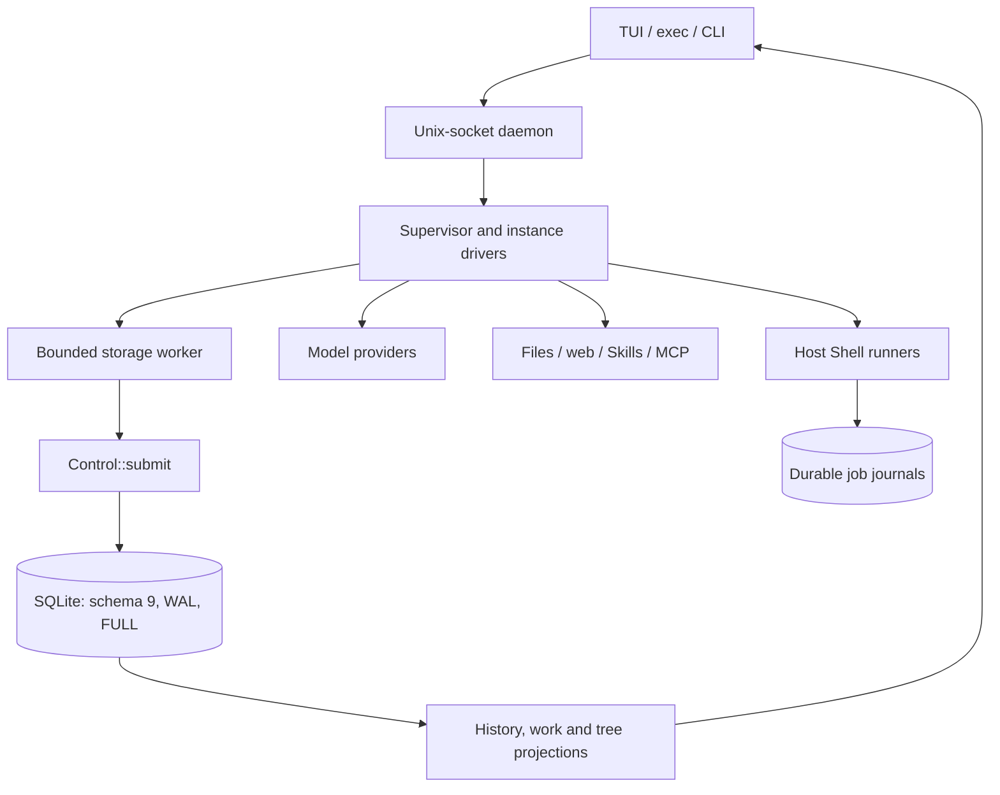
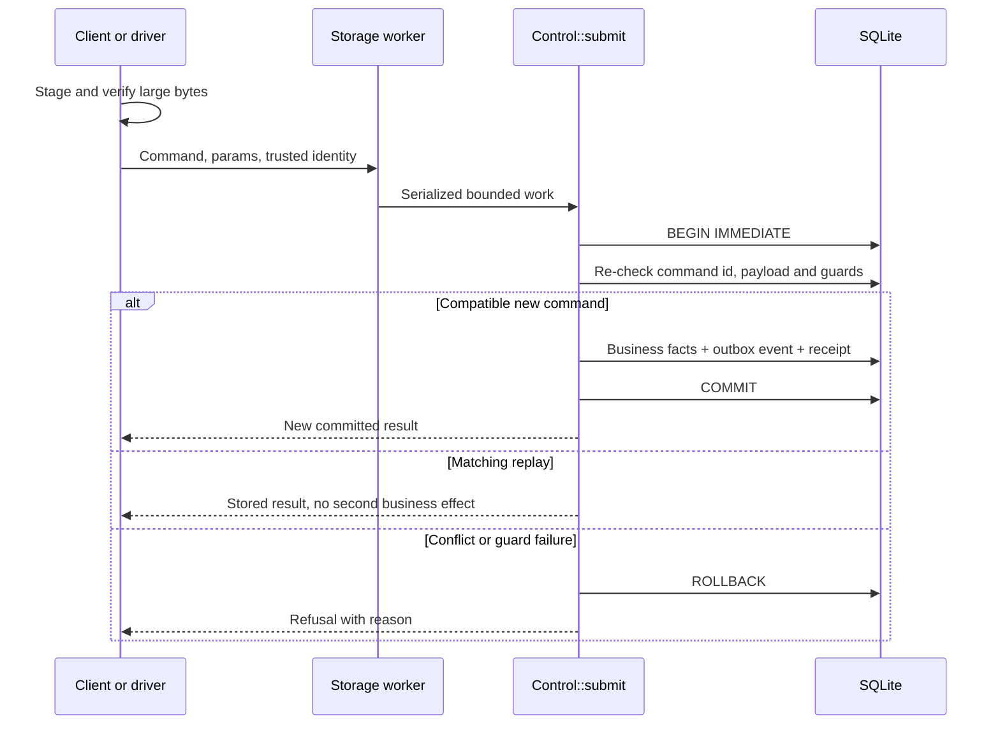
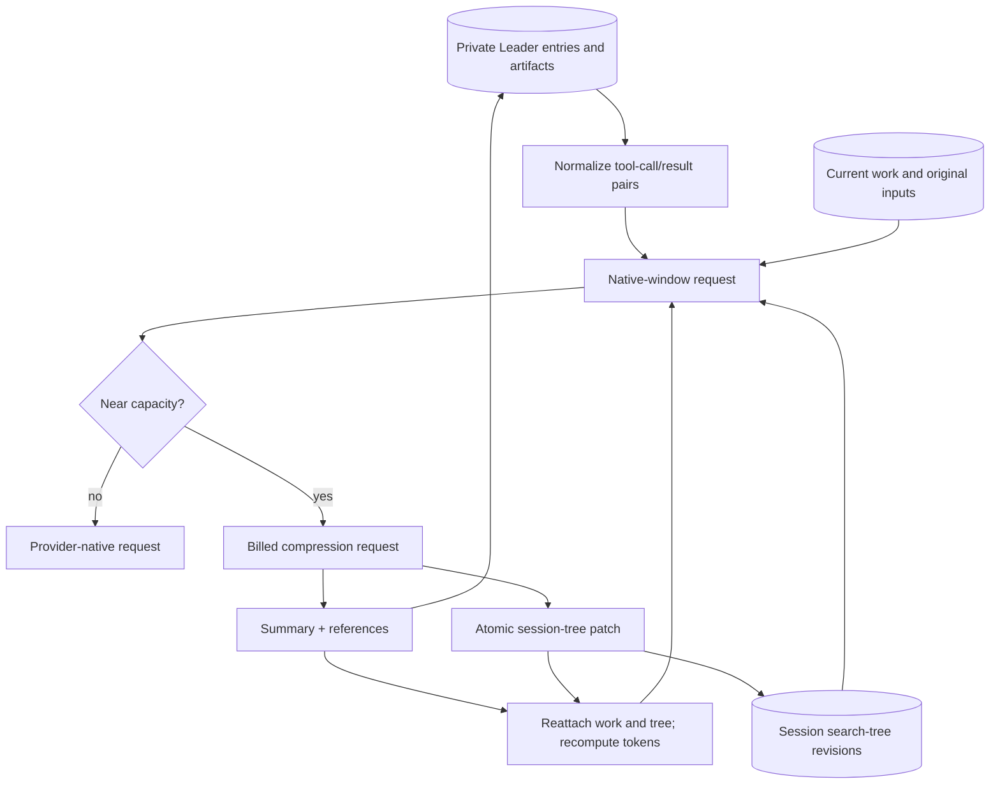

# Current architecture

This guide describes the current Rust runtime, authoritative state and verification boundaries. For product
requirements see [DESIGN.md](DESIGN.md); for evidence see [ACCEPTANCE.md](ACCEPTANCE.md).

## 1. Component ownership

- `core/src/kernel` prepares requests and interprets complete responses without owning I/O.
- `core/src/v2/control.rs::Control::submit` is the single team-transaction entry point.
- `core/src/v2/store.rs` owns format checks, migrations, WAL and `synchronous=FULL`.
- `engine/src/v2/supervisor.rs` coordinates ACTIVE instances; each driver owns one phase machine.
- `engine/src/v2/daemon.rs`, `engine/src/v2/exec.rs`, `engine/src/cli.rs` and `tui/src/daemon_client.rs`
  expose the same runtime; TUI is presentation only.
- `tools/` contains development and verification utilities, not another runtime or evidence store.

## 2. Atomic team transaction

Identity, operation ids, permission revisions and sequence numbers are assigned by the control plane. Duplicate
command ids return the stored receipt only when method, params and identity match. A changed payload is refused.
Model and tool waits never hold the write transaction open.

## 3. Phase and recovery

Execution phase records where an instance is; lifecycle and work state decide whether and why it should continue.
A paused instance, blocked task, cancelled request and unknown operation are different facts.

1. **READY:** queued envelopes apply at the safe boundary. Work and the session-tree projection are attached.
2. **MODEL_PENDING:** the request is frozen and budgeted. Attempts have separate identities from the logical request.
3. **TOOLS_PENDING:** fixed intents dispatch under current grants. Durable operations record actual effects.
4. **WAITING:** registered conditions, timers and task results wake through the same transaction as the fact.
5. **COMPLETION_PENDING:** completion evidence and required checks gate settlement. Failure can repair or block.

After interruption, persisted location drives recovery. Known results are reused. In-flight losses are recorded as
`OUTCOME_UNKNOWN` and are never replayed on a guess. A late result remains in its original epoch and cannot settle
new work. User-only termination, interrupt, cancellation, pause and detachment remain separate operations.

## 4. Context, compaction and exploration tree

Compaction never deletes covered entries; they remain in history and readback. The retained tail is the current
working set. Only Leader compaction advances the shared tree, using the previous cumulative tree and newly visible
Leader entries. Member-private history is excluded.

Tree operations are revision-checked durable commands. Add/update/move/merge/focus and ordered pairs validate
against the preceding result and reject atomically. A failed compaction tree patch leaves the previous revision
stale and emits `search_tree_update_failed`; the summary and user's turn continue.

## 5. Authoritative data

Schema 9 stores SQL/JSON projections rather than duplicate mirror DTOs. Main records include:

| Record | Essential identity or constraint | Purpose |
|---|---|---|
| `instances` | `id`; persisted Leader role and lifecycle/phase/revision | Member identity and execution pointer |
| `work_scopes`, `work_states`, `work_inputs`, `work_requests` | Work id, instance, epoch and pending costs | Budget, admission, continuation and attribution |
| `tasks` | `id`, requester/assignee, work and revision | Delegation and result paths |
| `grants`, `capability_requests` | Subject/action/scope, parent/task and revision | Attenuated authority and user decision |
| `envelopes`, `input_revisions`, `input_attachments` | Envelope, epoch, sequence, revision and artifact | Ordered input, edits and immutable snapshots |
| `context_entries` | Instance, epoch, index and optional compression link | Original history, summaries and readback |
| `model_requests`, `attempts`, `decisions`, `operations` | Request/attempt/decision/operation ids and status | Frozen requests, selected responses and durable effects |
| `approvals`, `waits` | Operation/condition and status | Concrete approval and durable suspension |
| `artifacts` | Digest, owner, storage reference and completeness | Verified large bytes and lifecycle |
| `search_tree_revisions`, `search_tree_head` | Session/revision and unique cause reference | Append-only exploration snapshots and current head |
| `commands`, `command_results`, `events` | Command id, result digest and session sequence | Replay stability and ordered notifications |

## 6. Authority and privacy

Grants narrow only. A parent revocation cascades to derived grants. Spawned members have no ambient Shell grant.
MCP and web bindings are also authorization. A model response, repository instruction, Skill, hook or tree node
cannot mint a grant.

A user may inspect every instance's history. An instance may read only its own private history. Visibility and
push delivery differ: an observer gets a scoped payload, not necessarily an inbox delivery. The shared exploration
tree contains only Leader-visible information and already shared task results, never member-private context.

Shell, acceptance commands and local MCP run on the host. This is not OS confinement. Escaped descendants,
remote effects and undeclared writes are outside the local process-group observer's guarantee.

## 7. Protocol and presentation

The daemon speaks JSON lines over a per-user Unix socket. Business commands carry a stable `command_id` for
reconnect deduplication. Events carry session, sequence, kind and a visible payload reference. Reconnect starts
from one consistent checkpoint/watermark, then reads newer events. Streaming previews are transient.

The TUI has one Leader conversation with elevated prompts, grouped operations, conditional approvals and
Markdown/code/media rendering. `/tree` exposes the session exploration tree. `teamagents search_tree [--json]`
and session export read the same projection. No second business store or execution engine is created in the client.

## 8. Current verification architecture

Finite TLA+ models cover protocol slices, including `V2SearchTree`. Executable Rust tests exercise real SQLite,
drivers, fake providers, runner processes and random control walks. Kani covers selected arithmetic and capability
vocabulary proofs. PTY checks terminal behavior.

Current totals are 65 positive configurations in 62 traversals, 327 controls, 79 witnesses and 9 Kani harnesses,
plus 777 Rust tests. Search-tree coverage includes ordered pairs, 23 controls covering every non-`TypeOK` tree
claim and 11 witnesses. Witnesses demonstrate reachability only.

These results do not establish full Rust/SQLite refinement, whole-system composition, wide exhaustive completion
or Policy B source-bound equivalence. Live-model quality, external-provider/OAuth acceptance, clean-host
install/update/rollback and matched outcome/cost comparisons remain separate obligations.

## 9. Source map

| Area | Current source |
|---|---|
| Control and state | `core/src/v2/control.rs`, `core/src/v2/store.rs` |
| Request kernel | `core/src/kernel` |
| Driver and supervision | `engine/src/v2/driver.rs`, `engine/src/v2/supervisor.rs` |
| Search tree | `core/src/v2/control/search_tree.rs`, `verification/tla/V2SearchTree.tla` |
| Daemon and clients | `engine/src/v2/daemon.rs`, `engine/src/v2/exec.rs`, `tui/src/daemon_client.rs` |
| Effects and integrations | `engine/src/tools.rs`, `engine/src/jobs`, `engine/src/mcp.rs` |
| Presentation | `tui/src/v2app.rs`, `tui/src/v2ui.rs`, `tui/src/transcript.rs` |
| Verification and tools | `verification/`, `tools/` |
